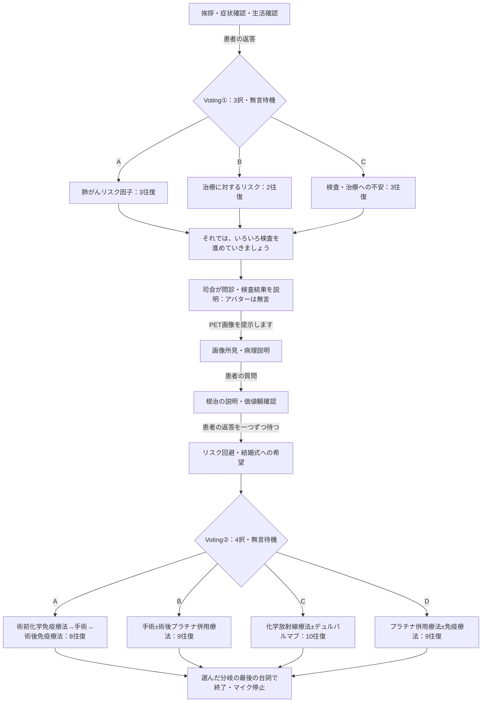
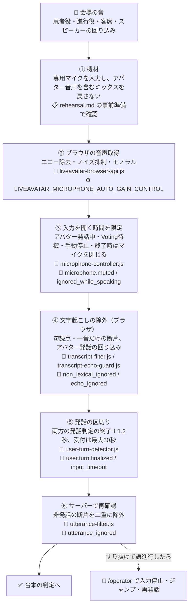
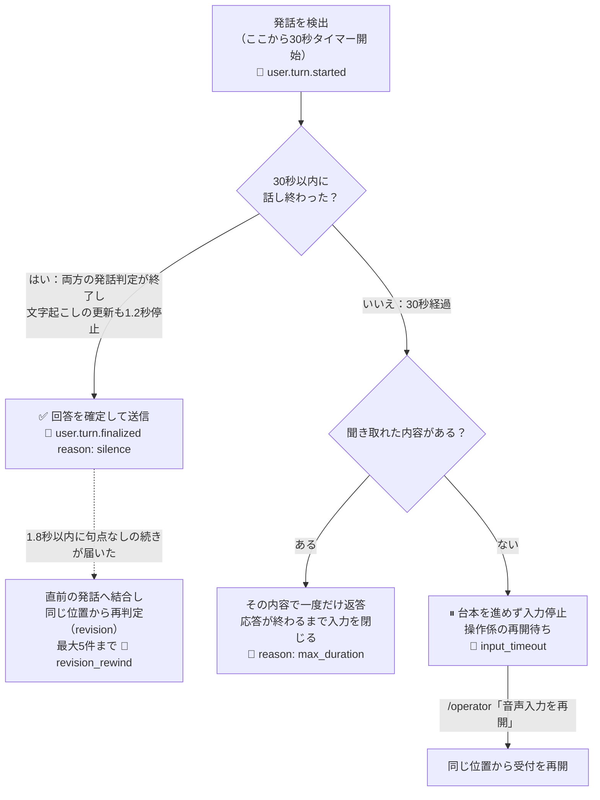

# yamamoto-avatar-scenario

肺癌学会ステージ企画向けの、**シナリオ駆動型AIアバター山本医師**デモです。

架空症例（76歳男性・右下葉肺扁平上皮癌・UIPパターン間質性肺炎併存）の台本に沿ってのみ、問診・検査説明・治療方針説明を行います。台本外の質問には定型応答で受け止めて台本に復帰し、LLMに自由回答はさせません。

> [!NOTE]
> 本デモは学会の教育・演出用です。実診療・医学的助言は提供しません。

## ドキュメントの地図

| 知りたいこと                           | 読む場所                                                                                                                                    |
| -------------------------------------- | ------------------------------------------------------------------------------------------------------------------------------------------- |
| 全体の流れ・本番当日の操作             | このREADME（[全体の流れ](#全体の流れ) / [本番オペレーション](#本番オペレーション)）                                                         |
| Mac・別のWindows PCでの起動と更新      | [docs/mac-windows-setup.md](docs/mac-windows-setup.md)                                                                                      |
| X-Gateへの接続手順                     | [X-GATE_connection.md](X-GATE_connection.md)                                                                                                |
| 台本とノードの対応・台本の差し替え     | [docs/scenario-map.md](docs/scenario-map.md)                                                                                                |
| 雑音・回り込み・誤進行への対策         | このREADME（[会場の音声入力](#会場の音声入力) / [本番向けの保護機構](#本番向けの保護機構)）、詳細は [architecture.md](docs/architecture.md) |
| 仕組み・API・状態同期                  | [docs/architecture.md](docs/architecture.md)                                                                                                |
| リハーサルで確認する項目               | [docs/rehearsal.md](docs/rehearsal.md)                                                                                                      |
| 本番向け改修の経緯・検証記録・障害調査 | [docs/production-hardening.md](docs/production-hardening.md)                                                                                |

## 会話の基本方針

本番の目的は、ユーザーの発話に自由回答することではなく、**有効な発話を受けて一区切りを確認し、現在の台本で決まっている応答を返して進行すること**です。話し始めや途中の文字起こしだけでは次へ進めません。区切りの判定と安全上の30秒上限は後述の「ユーザー発話の区切りと30秒上限」に従います。

`patient_any` は発話の完了を進行のきっかけにし、`patient_intent` も台本に用意された分岐を選ぶだけです。ユーザーの言い回しに合わせて新しい回答や説明を作りません。本番は `SCENARIO_SPEECH_MODE=fixed` を使用し、LLMは文字起こしの補正・意図分類の補助に限ります。

開始挨拶、`auto` で連結する説明、Voting結果などのオペレーター操作は、台本に定義された別の開始条件です。無音・雑音だけで患者応答待ちを通過させず、「待って」「もう一度」は既定の保留・再発話として扱います。

## 全体の流れ



- 転記用台本は [haigan-2026-script.md](data/scenarios/haigan-2026-script.md)。患者名は「鈴木さん」に統一しています。
- 追加問診は **3択**、治療説明は **4択**。会場が選んだ各1パターンを実演します。操作画面のA/B/C（治療はDも使用）と、会場画面の1/2/3/4キーが対応します。問診待機で4キーを押しても進みません。
- 各分岐は患者の返答ごとに次の医師の台詞を読みます。治療説明を一括で最後まで読まず、質問・返答の順序を保ちます。
- Voting待機は無言でマイクを停止します。投票案内や旧台本の共通クロージングは追加しません。
- 問診終了後は司会の説明を無言で待ちます。「PET画像を提示します」「PET/CTの画像を提示します」など、JSONに登録した文全体の合図で再開します。「画像はまだ準備中です」「検査って何ですか」では発話も進行もしません。この待機中は合図検出用に入力を受け付けます。
- 台本どおりでない症状の訴えには既存の安全網を残しています。病理説明後の相づちでは根治の説明を経由せず、価値観確認へ進みます。

全65ノードと台本の対応、原稿の誤字修正箇所は **[docs/scenario-map.md](docs/scenario-map.md)** を参照してください。

## 画面と役割

| URL                             | 使う人         | 内容                                                         |
| ------------------------------- | -------------- | ------------------------------------------------------------ |
| `/xgate?autostart=1&controls=0` | 会場スクリーン | アバター全画面表示（クロマキー・字幕対応）                   |
| `/operator`                     | 進行担当者     | 現在ノード・intent判定・Voting分岐ボタン・救済操作・進行ログ |
| `/index.html`                   | 開発者         | デバッグ画面（接続ログ・進行ログを表示）                     |

`/` と未知のパスは `/xgate` にリダイレクトされます（デバッグ画面は `/index.html` を明示的に開いてください）。

会場画面は最初に `/access` で `OPERATOR_TOKEN` を入力します。認証はHttpOnly・SameSite=Strictの署名付きCookieで12時間有効です。本番直前に認証を確認してください。`/xgate?shortcuts=1` で開くと、同一PCから `1/2/3/4`=分岐選択、`n`=次へ（強制）、`r`=再発話、`m`=音声入力の停止／再開 のキーボード操作も使えます。キーの押しっぱなしによる連続実行は無視します。トークンをURLに含めないでください（旧`optoken`は読み取り後にURLから除去します）。

## セットアップ

Node.js 22.13以降を使用します。DockerもNode.js 22系です。

Windows PowerShellでの初期設定、Macとのコード更新、2台で表示・操作を分ける手順は [Mac・Windowsセットアップガイド](docs/mac-windows-setup.md) を参照してください。

```bash
npm install
cp .env.example .env
# .env に LIVEAVATAR_API_KEY / OPENAI_API_KEY / OPERATOR_TOKEN を設定
npm run dev   # → http://localhost:3000
```

起動時に接続設定と台本のスキーマを検証します。`LIVEAVATAR_SELF_CONTROLLED=true`（既定）と `LIVEAVATAR_MODE=FULL` 専用です。`NODE_ENV=production` では固定台詞以外を拒否します。旧 `LIVEAVATAR_CONTEXT_ID` / `LIVEAVATAR_LLM_CONFIGURATION_ID` の経路は削除しました。

## 主要な環境変数

| 変数                                      | 説明                                                                                                              |
| ----------------------------------------- | ----------------------------------------------------------------------------------------------------------------- |
| `SCENARIO_ID`                             | シナリオID（既定: `haigan-2026`）                                                                                 |
| `SCENARIO_DIR`                            | シナリオJSONの配置先（既定: `./data/scenarios`）                                                                  |
| `SCENARIO_SPEECH_MODE`                    | `fixed`（既定・本番必須）/ `paraphrase`（LLM言い換え+禁止語チェック、非本番の検証用）                             |
| `SCENARIO_INTENT_LLM`                     | キーワード不一致時にLLMでintent分類するか（既定: true）                                                           |
| `OPERATOR_TOKEN`                          | 会場・操作画面とAPIの共通認証トークン（**必須**。未設定では起動失敗）。十分に長いランダム値を設定する             |
| `LIVEAVATAR_ALLOW_INTERRUPT`              | 既定`false`＝アバターが話し切るまで患者音声を無視（会場の雑音・回り込み対策）。`true`で割り込み可                 |
| `LIVEAVATAR_TRANSCRIPT_DEBOUNCE_MS`       | 発話検出が終了し、文字起こしの更新も止まってから確定まで待つ時間（既定`1200`ms）。1回の受付上限は別に30秒固定     |
| `LIVEAVATAR_TRANSCRIPT_CONTINUATION_MS`   | 通常確定後に遅着した句点なしの文字起こしを同じ発話へ結合できる時間（既定`1800`ms）。結合時は直前の遷移を再判定    |
| `LIVEAVATAR_MICROPHONE_AUTO_GAIN_CONTROL` | ブラウザの自動音量調整。既定`false`。ミキサーで音量を調整する運用を想定。直結マイクで必要なら`true`にして実機確認 |
| `DIALOGUE_LLM_TIMEOUT_MS`                 | LLM 1処理の制限時間（既定6000ms、再試行を含む）。時間切れ時は分類不一致・元の文字起こし・固定台詞へフォールバック |
| `LIVEAVATAR_*` / `OPENAI_*`               | LiveAvatar・OpenAI接続設定（`.env.example` 参照）                                                                 |

## 台本（シナリオ）の編集

実行用台本は `data/scenarios/haigan-2026.json` に入っています。患者の台詞を含む転記用原稿は `data/scenarios/haigan-2026-script.md` です。セリフの修正・監修反映はこのJSONの編集で行い、進行ロジックのコード変更は不要です。ただし読み上げ用のひらがな表（下記）への追加は必要です。

- `"placeholder": true` のノードは監修前の仮テキストです。どこが仮のままかは [docs/scenario-map.md](docs/scenario-map.md) を参照
- 新台本の問診3分岐・治療4分岐を患者との会話単位で転記済みです。`placeholder` が残るのは台本外の症状への安全網のみです。無言のVoting待機・終端は `doctorLines: []` です
- 原稿を更新するときは転記用Markdown・実行用JSON・読み仮名表を揃えます。`caseFacts` は参考情報で、台詞や判定を自動生成しません
- 差し替え後は `npm test` で全経路（Voting①3分岐 × Voting②4分岐 = 12経路）の通過を自動確認できます
- 起動時にスキーマ検証され、不正なJSON（未定義ノード参照など）はエラーで停止します
- 台本は起動後にキャッシュされるため、変更の反映にはサーバー再起動と会場・操作画面の再読み込みが必要です
- セリフ（`doctorLines` / `globalDeviationReplies`）を追加・変更したら、`src/features/dialogue/script-readings.js` に**文単位のひらがな読み**を追加してください。未登録の文が残ると `npm test`（`script-readings.test.js`）が失敗します。字幕・エコー判定は漢字の台本のまま、音声（speechText）だけを読みに置き換えます
- 台本以外にも効く医療用語の読み仮名は `src/features/dialogue/speech-pronunciation.js` に追加します（文単位の読みを適用した後に語単位で置換）

## 本番オペレーション

1. `/operator` を開き `OPERATOR_TOKEN` で接続
2. 進行がVoting待機に達すると分岐ボタン（Voting①はA/B/C、Voting②はA/B/C/D）が表示される → 会場の投票結果・司会の声掛けに合わせて押す（台本の①/②/③/④と同じ順）
3. 問診終了後は司会へ引き継ぐ。画像提示の合図を出す前に入力が再開されていることを確認し、「PET画像を提示します」または「PET/CTの画像を提示します」と発話するとシーン2へ進む
4. 困ったときは下表の救済操作を使う
5. 司会進行・拍手の間は **音声入力を停止**。患者役・進行役の合図を受ける前に **音声入力を再開**。Voting待機と終了時は自動でマイクを閉じます。手動停止は分岐選択や再接続後も維持されます（リセットで解除）。

| 操作               | 使う場面                                           | 起きること                                     |
| ------------------ | -------------------------------------------------- | ---------------------------------------------- |
| **次へ（強制）**   | 患者が固まった・沈黙が続く                         | 次のノードへ進めて、そのセリフを話す           |
| **再発話**         | 聞き取れなかった・音声エラーが出た                 | 直前に確定したセリフのまとまり全体を読み直す   |
| **ジャンプ**       | サーバー再起動からの復帰、リハーサルで任意の位置へ | 指定したノードへ移動して、そのセリフを話す     |
| **リセット**       | 最初からやり直す                                   | 先頭へ戻す（手動の入力停止も解除）             |
| **音声入力を停止** | 司会進行・拍手など、患者の声以外が入る間           | 進行位置を保ったままマイクと文字起こしを閉じる |
| **音声入力を再開** | 患者役・進行役の発話を受ける直前、30秒上限の停止後 | 同じ位置から受付を再開する                     |

分岐・強制送り・ジャンプ・再発話・リセットは、古い発話キューを置き換えます。「再発話」は直前に確定した台詞のまとまり全体を読み直します（画像所見と病理説明など、自動遷移で連結した台詞も含む）。操作画面は送信中の連打を防ぎ、サーバーも進行番号が古い操作を409で拒否します。

`/operator` の「会場画面」は進行SSEの接続状態と、ブラウザから届いた発話通知・音声エラーを表示します。「送信しました」や「発話終了通知あり」は実際にスピーカーから音が出たことの確認ではありません。実音は進行担当者が確認し、必要に応じて再発話してください。

> [!IMPORTANT]
> 進行状態はサーバーメモリのみで保持されるため、本番は単一インスタンスで運用します。サーバー再起動後、接続中だった会場画面は新しいサーバー世代に同期してマイクを停止します。操作画面の「サーバー再起動」の表示を確認し、**ジャンプで中断位置を指定**してください（最初からやり直す場合はリセット）。冒頭の台詞は自動再生しません。LiveAvatarだけの再接続時は直近10分以内の進行を引き継ぎ、直前の台詞をまとまりの先頭から再発話します。接続中は60秒ごとのkeep-aliveで引き継ぎ期限も更新します。

## 会場の音声入力

雑音対策は一か所ではなく、機材からサーバーまで何層にも重ねています。どれか一つで完全に防げるものではないため、層を外さないでください。図の 📄 は担当ファイル、⚙️ は設定、🔎 はその層が動いたときに出るログです。



本番は患者役・合図を出す進行役の専用マイクを入力し、アバター音声や会場全体のミックスを入力に戻さない構成をリハーサルで確認してください。ソフトウェアのノイズ抑制だけでは、客席の声と患者の声を確実に区別できません。

LiveKitの音声取得では `echoCancellation=true` / `noiseSuppression=true` / モノラルを明示します。自動音量調整は上記環境変数で選択できます。会場音響担当者と入力レベルを合わせ、静かな短答・咳・拍手・最大音量のアバター再生を同じ配線で確認してください。[LiveKitの音声取得設定](https://docs.livekit.io/reference/client-sdk-js/interfaces/AudioCaptureOptions.html)

## ユーザー発話の区切りと30秒上限

LiveAvatarの `user.speak_started` / `user.speak_ended` と、LiveKitの発話状態を併用する。どちらかが発話中なら待ち、両方が発話中でなくなってから、文字起こしの更新停止も含めて1.2秒（上記設定の既定値）確認して回答を確定する。途中で句点付きの文字起こしが届いたり、発話判定が一瞬外れたりしても、すぐにマイクを閉じない。[公式イベント仕様](https://docs.liveavatar.com/docs/full-mode/events)



1回の受付は**最初の発話検出から最大30秒**。発話通知が届かない場合は最初の有効な文字起こしから数える。断片・開始通知が追加されても期限は延長しない。声を検出していない無音待機には、この30秒タイマーを開始しない。

通常の無音確定後に句点なしの文字起こしが遅れて届いた場合は、既定1.8秒以内に限り直前の発話へ結合し、`revision` として同じ進行位置から再判定する。継続チェーンは初回確定を含め最大5件で打ち切る。30秒上限で確定した場合は後続入力を閉じるため、この結合は行わない。

- 上限までに聞き取れた内容がある場合: その内容を一度だけ対話APIへ送り、アバターが返答する。後続の入力は応答が終わるまで閉じる。
- 有効な文字起こしがない場合（句読点だけ・エコー等の除外後）: 台本を進めず、マイクを停止する。操作画面は「停止中（操作係の再開待ち）」になり、「音声入力を再開」で同じ位置から受付を再開できる。
- 停止状態のサーバー同期に失敗しても会場画面の入力は閉じたまま。操作画面で入力状態を確認し、必要なら「音声入力を停止」→「音声入力を再開」で復帰する。

ブラウザの `user.turn.finalized` ログで、区切りの理由（`silence` / `max_duration`）、経過時間、両方の発話判定を確認できる。聞き取りなしでの上限停止はサーバー・操作画面にも `input_timeout` と記録する。検出結果が実際の発話と一致することは会場機器で確認し、客席の会話が意味のある文字列として認識される問題には専用マイク・入力停止も併用する。

## 本番向けの保護機構

| 事象                                                            | 対策（自動）                                                                                         |
| --------------------------------------------------------------- | ---------------------------------------------------------------------------------------------------- |
| ASRが出す句読点だけ・一音だけの断片で台本が飛ぶ／発話が中断する | 非発話の断片をブラウザ・サーバー双方で無視（「はい」等の短答は通す）                                 |
| スピーカーの音がマイクに回り込み、患者発話として誤認される      | エコーガード: 直近のアバター発話とほぼ同一の文字起こしを無視                                         |
| アバターの発話中に会場の雑音や咳で発話が中断される              | 応答中（判定〜発話完了）はマイク音声の送信を停止し、文字起こしも無視                                 |
| 発話が途切れて結合再送され、台本が二重に進む                    | 結合再送に`revision`フラグを付け、サーバーが直前の患者遷移を巻き戻してから再判定                     |
| 開始挨拶が無音（エージェント入室前にコマンドが失われる）        | アバター音声トラックの到着を待って挨拶を送信 + `speak_started`未着時は一度だけ自動再送               |
| `speak_started/ended`イベントの取りこぼしで音声が止まる         | 開始未着は一度再送。開始・終了を確認できなければ入力を閉じ、操作画面に音声エラーを通知。再発話で復旧 |
| `autostart=1`でブラウザの自動再生制限により音が出ない           | 「🔊 タップして音声を有効にする」オーバーレイを表示                                                  |
| セッション切断（時間切れ・ネットワーク断）                      | `autostart=1`時は自動再接続（3回まで、進行は引き継ぎ）                                               |
| Start処理中にStopが割り込み、以降の発話が届かなくなる           | 起動処理を世代管理し、割り込み時は中断（sessionIdは起動時に確定した値を固定使用）                    |
| LLM判定待ちの間にオペレーターが操作                             | 古い判定結果を破棄し、オペレーター操作を優先                                                         |
| 未知・未指定のセッションID、認証のない公開APIへのアクセス       | 会場・操作・ログ・LiveAvatar APIを認証し、対話APIは起動直後も未知・未指定IDを拒否                    |
| 会場画面でのキー誤操作                                          | `controls=0`時は`s`（セッション停止）キーを無効化                                                    |

追加の運用対策:

- Voting待機・終端・手動入力停止・進行SSE切断中は、マイクと文字起こし受付を閉じる。台詞には進行番号とは別に`speechId`とセグメント番号・総数を付け、operator台詞は全件受信してから再生する。部分受信で切断しても、同じ進行番号の台詞を復帰時に回収する。
- LiveAvatarの `event_id` / `source_event_id` で発話通知を照合。送信する `event_id` は接頭辞なしのUUIDを使用する（`segment-` 等を付けると実サービスが発話を受け付けない）。`user.speak_ended` はアバター終了として扱わない。[公式イベント仕様](https://docs.liveavatar.com/docs/full-mode/events)
- 切断・Stop時は、その接続のSSE・タイマー・発話キューを破棄。古い接続の通知は新しい接続に影響させない。停止済みトークンの短時間キャッシュは廃止。
- 60秒ごとにLiveAvatarのkeep-aliveを送信し、Voting中の無音待機によるidle timeoutを避ける。最大セッション時間・利用枠は延長しない。[公式keep-alive API](https://docs.liveavatar.com/api-reference/sessions/keep-session-alive)
- API待機時間を制限。発話コマンドの送信失敗は最大3回で止め、入力を閉じて再発話で復旧する。SDKの送信・マイク操作自体が8秒で完了しない場合は、その接続を終了してStartによる再接続を待つ。対話ストリームが途中で切れた場合も入力を閉じ、操作係が現在ノードを確認して再発話する。
- 複数タブの起動防止はWeb Locksを優先し、タブ異常終了でも自動解放する。非対応ブラウザは30秒の短期リースを使用する。自動再接続を3回使い切った場合はStartを再度有効にする。
- マイク操作は `public/microphone-controller.js` に分離し、適用順と再試行を一か所で管理する。`LIVEAVATAR_ALLOW_INTERRUPT=true` の場合は応答中の自動ミュートをしない（本番はfalseを推奨）。

> [!WARNING]
> **接続時間の上限**: 2026-09-22の実セッションで、300秒（5分）後に `MAX_DURATION_REACHED` で映像・音声が終了したことをLiveAvatar APIで確認した。公式案内の上限はStarterが5分、Essentialが20分、Businessが60分（同日確認）。本番は接続開始からVoting待ち・患者の返答を含む全体の時間に余裕を加え、収まる契約を用意する。keep-aliveでこの上限は延長できず、自動再接続にも映像・音声の中断が伴う。[公式プラン案内](https://help.heygen.com/en/articles/10035615-how-to-get-started-with-liveavatar) / [調査記録](docs/production-hardening.md#追記-5分で映像音声が切れる原因)

トラブル時は `/operator` の進行ログとサーバーログを確認してください。`utterance_ignored`（非発話の断片を無視）、`echo_ignored`（回り込みを無視）、`user.turn.finalized`（発話を区切った理由）、`input_timeout`（30秒間に有効な文字起こしがなく入力停止）、`watchdog.speak_start_retry`（発話コマンド再送）、`revision_rewind`（言い直しによる巻き戻し）、`microphone.muted` / `microphone.unmuted`（発話中のマイク開閉）が該当ログです。

リハーサル用の手動チェックリストは [docs/rehearsal.md](docs/rehearsal.md) にあります。

## 台本外発話への応答（逸脱ハンドリング）

予後・費用・薬剤選択などの断定を求められた場合は「専門チームで検討し、あらためてご説明します」で受け、現在の質問を再提示して台本に戻ります。雑談には一文で応じ、聞き取れない場合は聞き返します。分類ルールと定型文の一覧は [docs/scenario-map.md](docs/scenario-map.md) の末尾を参照してください。

この分類は症状確認・病理説明の `patient_intent` ノードで行います。司会の合図待ちは例外で、登録した合図以外には無言で待ちます。`patient_any` ノードは有効な発話なら内容を問わず進むため、模擬患者役が台本に沿って返答する前提です。

患者との会話中は「待ってください」で保留し、「もう一度お願いします」で直前の説明を繰り返します。司会の合図待ちではこれらにも無言で待機し、必要な再発話は操作画面から行います。この2種類は`patient_any`でも進行しません。症状なしの定型返答は文全体で照合し、「眠れない」の「ない」だけでは症状なしにしません。その他のintentのキーワードは否定を考慮し、複数候補や「咳が止まらない」のような解釈の難しい否定はLLM分類へ回します。判定できなければ聞き返し、単語の個数で進行を決めません。費用などの台本外質問はキーワード一致より先に判定します。

エコー判定は文ごとに双方向の類似度を確認し、12文字未満の返答や「よろしくお願いします」の返礼、質問の一部を復唱した答えを除外しません。短い回り込み音声と患者の返答は文字列だけでは区別できないため、専用マイクと会場音響の分離は必須です。

## テストと品質確認

```bash
npm test        # 全12経路、音声制御、切断復帰、操作競合、SSE、認証、LLMタイムアウト等
npm run test:browser # Chromeで認証・会話・操作画面を確認。外部API/LiveKitは模擬、実マイクは使わない
npm run lint
npm run format
```

ブラウザテストはChromeを使用します。macOS以外や別の配置では `CHROME_BIN` にChrome/Chromiumの実行ファイルを指定してください。一時プロファイルを使い、普段のブラウザや実セッションには接続しません。

## デプロイ

Render（Docker・単一インスタンス）を想定。`render.yaml` を参照し、`OPERATOR_TOKEN` / `LIVEAVATAR_API_KEY` / `OPENAI_API_KEY` はダッシュボードで設定してください。X-Gateとの接続手順は [X-GATE_connection.md](X-GATE_connection.md)。

HTTP公開時はHTTPSを使用してください。対話・ログ・LiveAvatar APIには認証Cookieまたは`Authorization: Bearer <OPERATOR_TOKEN>`が必要です。クロスオリジンアクセスは許可しません。更新後は会場画面・操作画面を再読み込みして、新しいSSE形式と認証を使う組み合わせに揃えてください。Dockerは`npm ci --omit=dev`で依存を固定し、非rootユーザーで起動します。

## アーキテクチャ・経緯

- 本番向け改善の変更点・設定差分・検証結果: [docs/production-hardening.md](docs/production-hardening.md)
- 設計詳細: [docs/architecture.md](docs/architecture.md)
- 本リポジトリは旧ガイドラインRAG版（`yamamotoavator-demo-`）から映像・音声・会話制御パイプラインを引き継ぎ、RAG検索をシナリオ状態機械に置き換えたものです。RAG関連コード（`/api/rag/*` alias・custom LLM endpoint等）は撤去済みです。旧設計資料は `docs/archive/`（現行実装とは一致しません）
