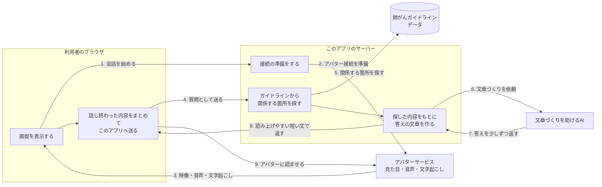
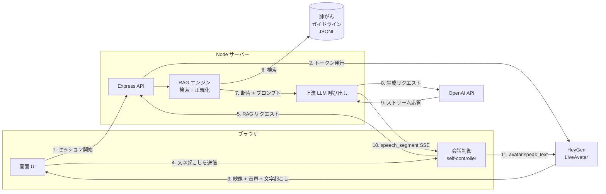
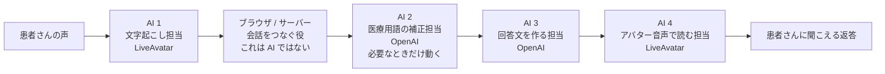
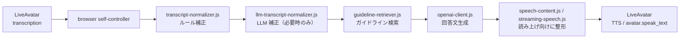
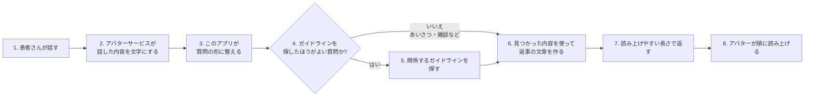
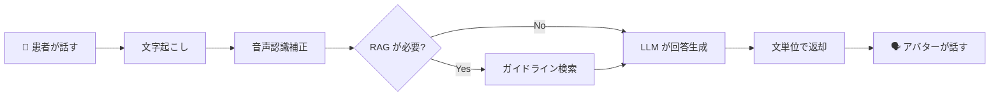
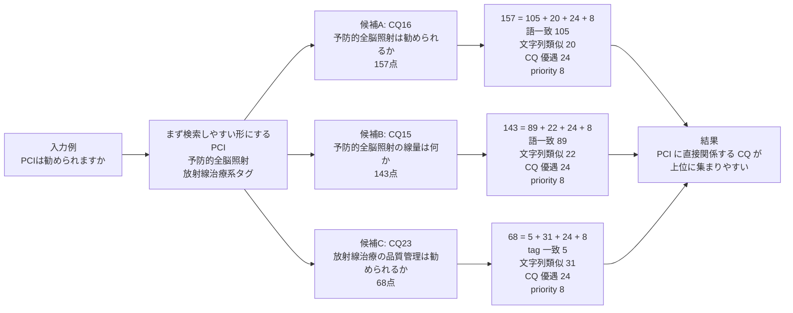

# yamamotoavator-demo

> <span style="color: red;"><strong>環境設定を行わずに動作を確認したい場合は、公開済みのデモをご利用ください。</strong></span> <strong><a href="https://yamamotoavator-demo.onrender.com">https://yamamotoavator-demo.onrender.com</a></strong>
>
> <strong style="color: black;">このデモ環境では、現時点では私の OpenAI API キーを利用しています。少しお試しいただく分には問題ありませんが、継続利用や正式運用を行う場合は、大学側で発行した API キーへ差し替えていただけると助かります。なお、この API キーには 5 ドルの利用上限を設定しており、上限に達した場合は自動的に停止します。</strong>
>
> <strong style="color: black;">Render の無料プランで動作させているため、返答まで時間がかかります。ローカル環境で起動した場合は、通常こちらよりも速く応答します。現在の標準 RAG は CQ と総論を混在させた hybrid JSONL を読み込みます。推奨・適応・線量のような具体質問では CQ を優先し、全体像や方針の broad query では総論 `souron` を先頭に寄せつつ全体を総論寄りに構成します。略語や作成方法の質問では `meta` を優先します。</strong>

HeyGen LiveAvatar を使った、肺がんガイドライン RAG 付き会話デモです。現在の標準構成は `self-controlled` で、LiveAvatar は「アバター表示 + 音声入出力 + transcription」、回答生成はこのサーバー側の RAG が担当します。

ここでいう `RAG` は、ひとことで言うと「先にガイドラインの関係箇所を探してから、その内容を見ながら答えるやり方」です。



実装寄りに見ると、現在の標準経路は次です。



## AI の役割分担

今の標準構成では、「AI が 1 人いて全部やる」のではなく、役割ごとに分かれています。ざっくり言うと、今の会話には 4 つの担当があります。



担当ごとに言うと次です。

- `AI 1 文字起こし担当`
  - 患者さんの音声を文字にします
  - 標準構成では LiveAvatar 側です
- `AI 2 医療用語の補正担当`
  - `全能照射` のような崩れた文字起こしを、`全脳照射` のように医療用語として直します
  - `対岸` のような崩れた文字起こしを、`肺がん` のように会話文脈に合う医学用語へ直すことがあります
  - 必要なときだけ動きます
  - 標準構成では OpenAI 側です
- `AI 3 回答文を作る担当`
  - ガイドラインの検索結果を見ながら、患者さん向けの自然な説明文を作ります
  - 標準構成では OpenAI 側です
- `AI 4 読み上げ担当`
  - 作られた文章をアバターの声で読みます
  - 標準構成では LiveAvatar 側です

補足:

- `AI 2` と `AI 3` は、どちらも OpenAI 側を使います
- ただし役割は別です
  - `AI 2` は「文字起こし補正だけ」
  - `AI 3` は「回答文づくり」
- ブラウザとこの Node サーバーは、会話を整理して各担当へ渡す「交通整理役」であり、ここ自体は AI ではありません

実装寄りに見ると、現在の標準構成での担当分担は次です。



> 開発運用メモ: 作業ルールは [`agent.md`](./agent.md) を参照してください。コード、設定、環境変数、起動手順、運用手順、画面挙動に変更を加えた場合は、`README.md` と必要な詳細ドキュメントに必ず反映します。

## まず何をすればよいか

| 目的                                 | まず読む場所                                           |
| ------------------------------------ | ------------------------------------------------------ |
| とりあえずローカルで起動したい       | [Setup And Operations](./docs/setup-and-operations.md) |
| このアプリの全体像だけ掴みたい       | [Overview](./docs/overview.md)                         |
| コードをどこから読めばよいか知りたい | [Architecture And File Guide](./docs/architecture.md)  |
| RAG の挙動だけ詳しく知りたい         | [RAG Deep Dive](./docs/rag-deep-dive.md)               |
| LLM がどこでどう呼ばれるか知りたい   | [LLM Workflow](./docs/llm-workflow.md)                 |
| 1 問が実際にどう流れるか追いたい     | [EGFR Query Trace](./docs/egfr-trace.md)               |
| X-Gate 実機での出し方を知りたい      | [X-GATE_connection.md](./X-GATE_connection.md)         |

## 最短スタート

### 1. `.env` を作る

```bash
cp .env.example .env
```

標準構成は `.env.example` をベースにそのまま使う前提です。最低限、空欄の項目を埋めてください。

```env
LIVEAVATAR_API_KEY=
OPENAI_API_KEY=
LIVEAVATAR_LANGUAGE=ja
LIVEAVATAR_SELF_CONTROLLED=true
```

補足:

- `.env.example` には動作確認用の `LIVEAVATAR_AVATAR_ID` と `LIVEAVATAR_VOICE_ID` の例を入れています
- 利用するアバターや voice を固定したい場合は、その値を自分の環境向けに差し替えてください
- 現在の標準起動は `.env.example` をそのままベースにし、空欄の API キーを埋めて使う前提です
- `.env.example` では `LIVEAVATAR_SELF_CONTROLLED=true`、`OPENAI_MODEL=gpt-5-mini`、`RAG_LLM_TRANSCRIPT_NORMALIZATION_MODEL=gpt-5-mini` を設定しています
- `LIVEAVATAR_LANGUAGE` のコード既定値は `en` ですが、`.env.example` では `ja` に設定しています。日本語で使う場合は `.env` に `LIVEAVATAR_LANGUAGE=ja` を必ず入れてください

### 2. 起動する

```bash
npm install
npm run dev
```

### 3. ブラウザで確認する

- `http://localhost:3000/`
  - 現在のデフォルト表示です
  - `/xgate` にリダイレクトされます
- `http://localhost:3000/xgate`
  - 表示寄りの UI です
- `http://localhost:3000/index.html`
  - デバッグ用 UI です
  - 接続状態、Runtime Log、RAG Log を見ながら切り分けできます

セットアップ、Render 公開、環境変数一覧、動作確認、X-Gate 運用メモは [Setup And Operations](./docs/setup-and-operations.md) にまとめています。

## 今の標準構成

- 標準運用は `LIVEAVATAR_SELF_CONTROLLED=true` です
- これは `.env.example` と README 上の標準構成です
- いっぽうコード内部の既定値は `LIVEAVATAR_SELF_CONTROLLED=false`、`OPENAI_MODEL=gpt-4.1-mini` です
- そのため、`.env` を作らずにコード既定値だけで起動した場合は README の標準構成とは異なります
- LiveAvatar は「アバター表示 + 音声入出力 + transcription」を担当します
- 会話制御の中心はブラウザ側にあります
- 回答本文の生成はこのサーバー側の RAG が担当します
- 検索対象は `data/processed/lung-cancer-guideline-hybrid.jsonl` です
- 検索はベクトル検索ではなく、`cq / souron / meta` を対象にしたルールベース検索です
- `OPENAI_API_KEY` は今の標準会話フローでは実質必須です
- `LIVEAVATAR_CONTEXT_ID` と `LIVEAVATAR_LLM_CONFIGURATION_ID` は、今の標準 self-controlled 経路では不要です
- 会話履歴と RAG ログはメモリ保持のみで、永続化はしていません



実装寄りの処理順は次です。



この前提の詳しい説明は [Overview](./docs/overview.md) を参照してください。

### 検索スコアのイメージ

RAG の検索は「質問文をそのまま 1 回全文一致で探す」のではなく、まず質問を検索向けに言い換えてから、各候補に対して `title` `question` `recommendation` `tags` `文字列類似` などを見ながら点を足していきます。



この例では、`CQ23` も「放射線治療」という広い意味では少し関係があるので 68 点までは付きます。ただし `PCI` や `予防的全脳照射` が直接入る `CQ16` `CQ15` のほうが、語一致の点が大きく伸びるので上位に来ます。より詳しい説明は [RAG Deep Dive](./docs/rag-deep-dive.md) にあります。

## 読み方ガイド

初見の人には、次の順番を勧めます。

1. [Overview](./docs/overview.md)
2. [Setup And Operations](./docs/setup-and-operations.md)
3. [Architecture And File Guide](./docs/architecture.md)
4. 必要に応じて [RAG Deep Dive](./docs/rag-deep-dive.md)
5. さらに必要なら [LLM Workflow](./docs/llm-workflow.md)
6. 実際の 1 問を追うなら [EGFR Query Trace](./docs/egfr-trace.md)

## ドキュメント構成

### 1. 全体像

- [Overview](./docs/overview.md)
  - 今の実装を一言でいうと
  - 用語整理
  - 責務分担
  - 重要な前提
  - 技術スタック
  - 起動フローの俯瞰

### 2. 起動と運用

- [Setup And Operations](./docs/setup-and-operations.md)
  - セットアップ
  - Render で公開する
  - 動作確認
  - 環境変数
  - X-Gate メモ
  - 制約と未実装

### 3. コードを読むための地図

- [Architecture And File Guide](./docs/architecture.md)
  - ルートと責務
  - ファイル構造と各ファイルの役割
  - おすすめ読書順
  - `npm scripts`
  - custom LLM 構成

### 4. 実装深掘り

- [RAG Deep Dive](./docs/rag-deep-dive.md)
  - 検索方式
  - query intent
  - スコアリング
  - strict / fallback
  - 具体例とログの読み方
- [LLM Workflow](./docs/llm-workflow.md)
  - `user.transcription` 受信から SSE 返却まで
  - transcript 補正
  - `no_rag / rag_hit / rag_miss`
  - `content / speechContent`
  - アバター読み上げまでの流れ
- [EGFR Query Trace](./docs/egfr-trace.md)
  - `EGFR陽性の非小細胞肺がんの治療について教えて` の 1 問を実装順に追う

## 制約と未実装

- ベクトル検索は未実装です
- 永続 DB は未実装です
- テストは一部だけ入っていますが、全体を十分にカバーしているわけではありません
- RAG データは現状 `data/processed/lung-cancer-guideline-hybrid.jsonl` 前提で、内訳は 2025 CQ + 2024 `souron` / `meta` です
- Sandbox を使う場合は、利用可能アバターやセッション時間に制限があります

## 関連ドキュメント

- [`agent.md`](./agent.md)
  - この repo で作業する際の簡易運用ルールです
- [`X-GATE_connection.md`](./X-GATE_connection.md)
  - X-Gate へ `/xgate` を表示する運用メモです
