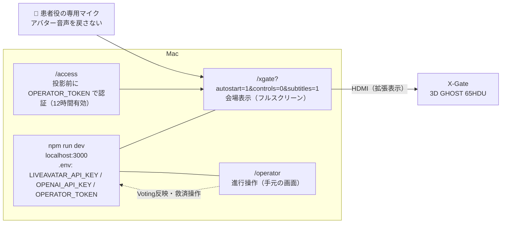

# X-GATE Connection Guide

Macでアプリをローカル起動し、X-Gateへ表示して本番運用する手順です。

別のWindows PCでの起動、WindowsからのHDMI出力、MacとWindowsで表示・操作を分ける場合は [Mac・Windowsセットアップガイド](docs/mac-windows-setup.md) を参照してください。

## まず前提

あなたのアプリは今、Node / Express で `localhost:3000` に立ち上がり、X-Gate 向けの出力ページ `/xgate`、進行担当者用の `/operator`、開発者用のデバッグ画面 `/index.html` をブラウザで開いて使う構成です（`/` は `/xgate` にリダイレクトされます）。

README でも `npm run dev` のあとに `http://localhost:3000` を開いて動作確認する流れになっていて、将来の拡張を見据えて LiveAvatar 連携をバックエンドに隔離しています。

また、X-Gate の 3D GHOST 65HDU は HDMI 対応でリアルタイム映像放映が可能で、3D アバターを表示してリアルタイム会話も可能という前提で考えます。つまり、Mac から X-Gate を外部ディスプレイとしてつなぎ、`/xgate` ページをその画面に出すのが基本手順です。

## 全体像



| 画面          | 映す場所           | 用途                               |
| ------------- | ------------------ | ---------------------------------- |
| `/xgate`      | X-Gate（外部画面） | アバターの全画面表示               |
| `/operator`   | 手元のMac画面      | Voting反映・救済操作・進行ログ     |
| `/index.html` | 手元のMac画面      | 接続確認・切り分け用のデバッグ画面 |

やることは大きく 3 段階です。

1. まず Mac 単体で `http://localhost:3000/xgate` が正常動作することを確認する
2. X-Gate を Mac に HDMI 接続し、外部ディスプレイとして認識させる
3. X-Gate 側の画面に `/xgate` を出して、フルスクリーンで運用する

## 1. どの画面を使うか

今のアプリには、用途が違う 3 つの画面があります。

### 確認用 UI

```text
http://localhost:3000/index.html
```

これはデバッグや接続確認用です。
ログや状態表示を見ながら、セッション開始や切り分けをするための画面です。

### 進行オペレーター画面

```text
http://localhost:3000/operator
```

会場Votingの結果を反映する画面です。**本番ではこれを別ウィンドウ（できれば手元の別画面）で開いたままにします**。
`.env` の `OPERATOR_TOKEN` を入力して接続してください。

### X-Gate 出力用 UI

```text
http://localhost:3000/xgate
```

これは X-Gate へ映すための出力専用ページです。
黒背景で、アバターを中央に大きく出し、HUD は最小限にしてあります。

## 2. まず Mac 単体で `/xgate` が動くか確認する

X-Gate をつなぐ前に、Mac の画面上で `/xgate` がちゃんと動くかを確認します。

やることはこれだけです。

1. Chrome を開く
2. `http://localhost:3000/xgate` にアクセスする
   - 初回は入場画面に移るため、`OPERATOR_TOKEN`で認証する（12時間有効）
3. `Start` を押す
4. マイク許可を出す
5. アバター映像と音声が出るか確認する

`/xgate` がうまく動かない状態で実機接続しても切り分けが難しいので、ここは必須です。

## 3. X-Gate を Mac に HDMI 接続する

次に、X-Gate を Mac の外部ディスプレイとしてつなぎます。

配線イメージはこれです。

```text
Mac
↓
USB-C → HDMI 変換アダプタ（必要なら）
↓
HDMI ケーブル
↓
X-Gate
```

X-Gate 65HDU は HDMI 対応モデルなので、このつなぎ方でリアルタイム映像を出す前提に合っています。

## 4. Mac が X-Gate を外部ディスプレイとして認識しているか確認する

Mac で次を開きます。

```text
Apple メニュー → システム設定 → ディスプレイ
```

ここで X-Gate 側が外部ディスプレイとして認識されていれば OK です。

確認ポイントは次です。

1. X-Gate が外部モニタとして見えている
2. ミラーリングではなく、できれば拡張表示になっている
3. 解像度が極端におかしくない

基本的には、X-Gate を 2 枚目の画面として使える状態にします。

## 5. まずは確認用 UI でも一度テストする

本番前に、必要なら既存の確認用 UI でも一度動作を見ます。

```text
http://localhost:3000/index.html
```

この画面はログが出るので、接続に失敗したときの切り分けがしやすいです。

おすすめの流れは次です。

1. まず `/index.html` で接続確認する
2. 問題なければ `/xgate` に切り替える

## 6. X-Gate 側にブラウザを移動する

Mac で Chrome の `/xgate` タブを X-Gate 側の画面へドラッグします。

その後、X-Gate 側の画面でこの URL を開きます。

```text
http://localhost:3000/xgate?autostart=1&controls=0&subtitles=1
```

この構成意図はこうです。

- `autostart=1`
  - ページを開いた時点で自動的にセッションを開始する（Start を押さなくてよい）
  - 予期しない切断からの自動再接続もこの指定のときだけ有効になる
- `controls=0`
  - HUD を自動で消して、出力画面っぽくする
  - あわせて `s`（セッション停止）キーを無効化し、誤操作で止まらないようにする
- `subtitles=1`
  - 字幕を出す

今のアプリは `/index.html` を確認用 UI、`/xgate` を出力専用、`/operator` を進行操作用に分ける設計なので、この運用が自然です。

## 7. X-Gate 側でフルスクリーンにする

X-Gate 側に出したブラウザでフルスクリーンにします。

方法は 2 つあります。

### 方法 A

ページ内の `Fullscreen` ボタンを押す

### 方法 B

ブラウザのフルスクリーン機能を使う

どちらでも OK です。
まずは X-Gate の画面いっぱいにアバターを出せれば成功です。

## 8. Start する

ここが本番開始手順です。

あなたの操作は次です。

1. X-Gate 画面で `http://localhost:3000/xgate?autostart=1&controls=0&subtitles=1` を開く
2. フルスクリーンにする
3. マイク許可を確認する（`autostart=1` なら Start は不要。押す場合は `Start`）
4. 開始挨拶が**音声で**流れることを確認する
5. 一度話しかけて、台本どおりに進むことを確認する

`🔊 タップして音声を有効にする` が出たら、ブラウザの自動再生制限で音がブロックされています。
画面をタップ（クリック）すれば解除されます。

手元では `/operator` を開いておき、進行ノードが想定どおり動いているかを見ながら進めます。

キーボードで進行も操作する場合は`&shortcuts=1`を追加します。トークンをURLへ含める`optoken`は使用しないでください。認証はスクリーンを客席へ出す前に済ませておきます。

発話は最長30秒で区切られます。30秒間に有効な文字起こしが得られなかった場合は、会場画面の入力が止まり、操作画面に「停止中（操作係の再開待ち）」と表示されます。音響とマイク状態を確認してから「音声入力を再開」を押してください。

操作画面に「音声エラー」が出た場合は、実音と接続を確認し「再発話」で復旧します。SDKの送信・マイク操作が時間切れの場合は接続自体を閉じるため、会場画面のStartで再接続してください。サーバー再起動時は入力停止のまま待機するので、操作画面のジャンプで中断位置を指定します。

ここまで通れば、X-Gate 上での表示運用は成立です。

## よくある確認事項

### 1. `localhost` で大丈夫？

大丈夫です。

今回の構成では、Mac 自身のブラウザで開いて、その Mac が X-Gate へ映像出力するので、URL は `localhost:3000` のままで問題ありません。

### 2. GitHub に上げないと X-Gate で見られない？

不要です。

GitHub はソース管理用であって、X-Gate は基本的に外部ディスプレイです。
まずは `ローカル起動 + HDMI` で十分です。

### 3. Docker にした方がいい？

今すぐは不要です。

`compose.yaml` もありますが、今すでに `npm run dev` で安定しているなら、まずはそのままで OK です。
Docker は再現性には有利ですが、現場トラブル時の切り分けはローカル起動の方が楽です。

## 最短手順だけ抜き出すと

1. `.env` に `LIVEAVATAR_API_KEY` / `OPENAI_API_KEY` / `OPERATOR_TOKEN` が入っていることを確認する
2. `npm run dev` を起動したままにする
3. Mac で `http://localhost:3000/xgate` が動くことを確認する
4. X-Gate を HDMI で Mac につなぐ
5. Mac のディスプレイ設定で外部画面として認識されていることを確認する
6. X-Gate 側の画面で `http://localhost:3000/xgate?autostart=1&controls=0&subtitles=1` を開く
7. フルスクリーンにする
8. 手元で `http://localhost:3000/operator` を開き、`OPERATOR_TOKEN` で接続する

## 補足

今のリポジトリは、LiveAvatar の `session token / start / stop` を backend に隠し、frontend は LiveKit 接続情報だけ受け取る設計です。なので、X-Gate に持っていくときも非常に扱いやすい構成です。

要するに、

- 接続確認や切り分けは `/index.html`
- 実際に映すのは `/xgate`
- 進行の操作は `/operator`

この使い分けで進めれば大丈夫です。

本番当日の通し確認は [docs/rehearsal.md](docs/rehearsal.md) のチェックリストを使ってください。
