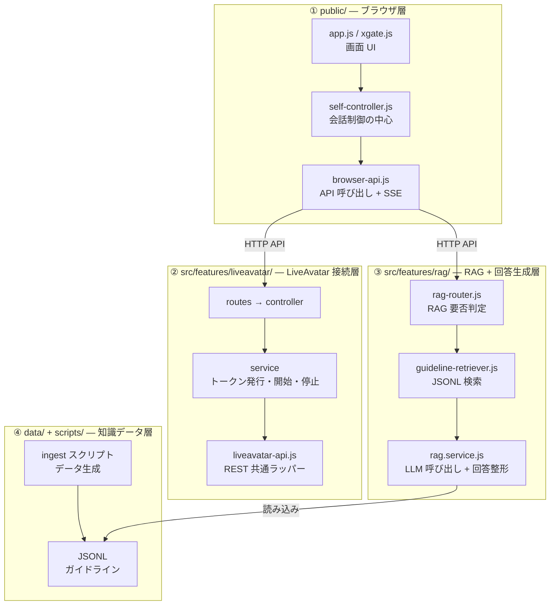
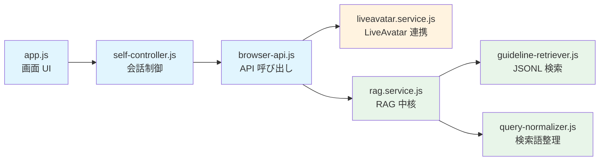

# Architecture And File Guide

このファイルは、ルート構成、責務分担、読み進める順番、主要ファイルの役割をまとめたアーキテクチャガイドです。コードを追いたい人はここから入ると迷いにくいです。

## ルートと責務

### サーバー側 API

| ルート                               | 役割                                                  |
| ------------------------------------ | ----------------------------------------------------- |
| `GET /api/health`                    | 生存確認                                              |
| `GET /api/liveavatar/config`         | フロントに公開してよい設定だけ返す                    |
| `POST /api/liveavatar/session-token` | LiveAvatar のセッショントークンを発行する             |
| `POST /api/liveavatar/start-session` | LiveAvatar セッションを開始し、LiveKit 接続情報を返す |
| `POST /api/liveavatar/stop-session`  | セッション停止                                        |
| `POST /api/rag/session`              | デバッグ用に sessionId を初期化・紐付けする           |
| `POST /api/rag/respond`              | self-controlled 用の回答生成                          |
| `POST /api/rag/respond/stream`       | self-controlled 用のストリーミング回答生成            |
| `GET /api/rag/logs`                  | メモリ上の RAG ログ参照                               |
| `POST /v1/chat/completions`          | OpenAI 互換 endpoint                                  |

### ブラウザ側の責務

- `public/app.js`
  - `/index.html` のデバッグ UI 全体
  - セッション開始・停止
  - LiveKit 接続
  - RAG ログ polling
- `public/liveavatar-browser-api.js`
  - ブラウザから `/api/liveavatar/*` と `/api/rag/*` を呼ぶ共通 API ラッパー
  - SSE 形式の `speech_segment` / `done` / `error` を解釈する
- `public/xgate.js`
  - `/xgate` の表示用 UI
  - HUD の自動非表示
  - 字幕表示
- `public/liveavatar-self-controller.js`
  - `user.transcription` をバッファして一定時間でまとめる
  - `/api/rag/respond/stream` を叩く
  - `speech_segment` を受けながら読み上げキューを組む
  - `avatar.speak_text` と `avatar.interrupt` を publish する
- `public/liveavatar-subtitles.js`
  - LiveAvatar から返る `avatar.*` イベントから字幕文字列を抜き出す
  - 字幕の終了イベントを判定する

ここで大事なのは、ブラウザが単なる画面ではなく、会話の制御役もしていることです。今の構成では「文字起こしを受ける」「RAG に問い合わせる」「返答文をアバターに読ませる」という会話オーケストレーションの中心がブラウザ側にあります。

---

## ファイル構造と各ファイルの役割

このセクションは、単なるファイル一覧ではなく「初見の人がどう読めば全体像を最短で掴めるか」を意識してまとめています。

### 最初に持つと分かりやすい見取り図

この repo は、大きく分けると次の 4 層です。



1. `public/`
   - ブラウザ側です
   - 画面表示だけでなく、会話制御の中心もここにあります
2. `src/features/liveavatar/`
   - LiveAvatar API との接続部分です
   - セッショントークン発行や会話開始・停止を担当します
3. `src/features/rag/`
   - 回答生成部分です
   - 「RAG が必要か判定する」「JSONL を検索する」「LLM に回答を書かせる」を担当します
4. `data/` と `scripts/`
   - 知識データ本体と、その生成・検証用スクリプトです

### 本当に最初に読む順番

アプリ全体を一番つかみやすい順番は次です。

1. `src/server.js`
   - サーバーの起点です
   - まず「Node アプリとしてどこから始まるか」だけ確認します
2. `src/app.js`
   - どのルートが登録されていて、どの HTML が返るかを見ます
   - ここで `/` と `/xgate` と `/api/*` の全体像が見えます
3. `public/app.js`
   - `/index.html` で開くデバッグ UI の本体です
   - ユーザー操作からどの API が呼ばれるか、LiveKit にどう接続するかが分かります
4. `public/liveavatar-self-controller.js`
   - この repo の肝です
   - 文字起こしを受けて RAG に送り、その返答をアバターに speak させる流れがここにまとまっています
5. `src/features/liveavatar/liveavatar.service.js`
   - ブラウザが叩いていた `/api/liveavatar/*` の裏側です
   - LiveAvatar API に実際に何を送っているかが分かります
6. `src/features/rag/rag.service.js`
   - もう一つの中核です
   - RAG 判定、検索、LLM 呼び出し、会話履歴保存、ログ記録が全部ここに集まっています
7. `src/features/rag/retrievers/guideline-retriever.js`
   - JSONL 検索の中身を知りたいときに見ます
   - どう点数が付くかはここです
8. `src/features/rag/query-normalizer.js`
   - `EGFR` や `PD-L1` などの同義語整理を見たいときに読みます

この 8 ファイルを順に追うだけで、「画面 -> API -> LiveAvatar 接続 -> RAG -> 検索」の主経路はほぼ把握できます。



### 読みながら何を見るか

初見の人は、各ファイルで全部を理解しようとしない方が速いです。見るポイントだけ絞ると次のようになります。

| ファイル                                             | 最初に見るポイント                                                 |
| ---------------------------------------------------- | ------------------------------------------------------------------ |
| `src/server.js`                                      | どの app を listen しているか                                      |
| `src/app.js`                                         | どの route 群が登録されているか                                    |
| `public/app.js`                                      | `Start Session` 押下後にどの API をどの順で呼ぶか                  |
| `public/liveavatar-self-controller.js`               | `user.transcription` をどうまとめ、どこへ送り、どう speak させるか |
| `src/features/liveavatar/liveavatar.service.js`      | LiveAvatar API にどんな payload を送るか                           |
| `src/features/rag/rag.service.js`                    | RAG する条件、検索結果の使い方、LLM 呼び出し方                     |
| `src/features/rag/retrievers/guideline-retriever.js` | JSONL にどうスコアを付けるか                                       |
| `data/processed/lung-cancer-guideline-hybrid.jsonl`  | RAG が実際に何を検索対象にしているか                               |

### 目的別のおすすめ読書ルート

#### 1. まずアプリ全体だけ把握したい

1. `src/app.js`
2. `public/app.js`
3. `public/liveavatar-self-controller.js`
4. `src/features/liveavatar/liveavatar.service.js`
5. `src/features/rag/rag.service.js`

この順番だと「画面から見た主経路」が先に入るので、実装が頭に入りやすいです。

#### 2. RAG だけ理解したい

1. `src/features/rag/rag.controller.js`
2. `src/features/rag/rag.service.js`
3. `src/features/rag/rag-router.js`
4. `src/features/rag/retrievers/guideline-retriever.js`
5. `src/features/rag/query-normalizer.js`
6. `src/features/rag/prompts/answer-prompt.js`
7. `src/features/rag/conversation.store.js`
8. `src/features/rag/rag-log.store.js`

この順番だと「入口 -> 本体 -> 判定 -> 検索 -> プロンプト -> 保存」の流れで追えます。

#### 3. LiveAvatar 連携だけ理解したい

1. `public/app.js`
2. `src/features/liveavatar/liveavatar.routes.js`
3. `src/features/liveavatar/liveavatar.controller.js`
4. `src/features/liveavatar/liveavatar.service.js`
5. `public/xgate.js`

この順番だと「ブラウザが何を求め、サーバーが何を返し、画面がどうつなぐか」が見えます。

### 読まなくてよいファイル

初回理解では、次は後回しで大丈夫です。

- `public/styles.css`
- `public/xgate.css`
- `public/index.html`
- `public/xgate.html`
- `src/features/liveavatar/liveavatar-llm.service.js`
- `scripts/provision-liveavatar-custom-llm.mjs`
- `scripts/inspect-liveavatar-llm.mjs`
- `scripts/update-liveavatar-llm.mjs`

これらは UI 見た目の調整や、今の標準経路では使っていない custom LLM 補助機能です。

### ルート構成

```text
.
├─ public/
├─ src/
├─ scripts/
├─ data/
├─ .env.example
├─ package.json
├─ package-lock.json
├─ compose.yaml
├─ Dockerfile
├─ render.yaml
├─ agent.md
├─ X-GATE_connection.md
└─ README.md
```

### ディレクトリごとの意味

| パス                          | まずの理解                                      |
| ----------------------------- | ----------------------------------------------- |
| `public/`                     | ブラウザ側。会話 UI と self-controlled 制御     |
| `src/`                        | Node/Express 側。API と RAG 本体                |
| `scripts/`                    | データ作成や LiveAvatar 補助設定用              |
| `data/`                       | RAG の検索対象データ                            |
| `.env.example`                | 標準の self-controlled 構成向け設定テンプレート |
| `package.json`                | Node 実行設定、依存関係、npm scripts            |
| `package-lock.json`           | 依存関係の lockfile                             |
| `compose.yaml` / `Dockerfile` | Docker 起動用                                   |
| `render.yaml`                 | Render Blueprint 用のデプロイ設定               |
| `eslint.config.js`            | ESLint 設定                                     |
| `.prettierrc.json`            | Prettier 設定                                   |
| `.prettierignore`             | Prettier 対象外パターン                         |
| `.gitignore`                  | Git 追跡対象外パターン                          |
| `.dockerignore`               | Docker ビルド対象外パターン                     |
| `agent.md`                    | この repo の作業ルール                          |
| `X-GATE_connection.md`        | X-Gate 接続の運用メモ                           |
| `README.md`                   | 現在の構成と運用手順の説明                      |
| `docs/`                       | 詳細ドキュメント群（README のリンク表から参照） |

### `src/` の読み方

| ファイル                        | 役割                                                               |
| ------------------------------- | ------------------------------------------------------------------ |
| `src/server.js`                 | サーバー起動エントリポイント                                       |
| `src/app.js`                    | Express 初期化、静的配信、ルート登録、`/` と `/xgate` の HTML 配信 |
| `src/config/env.js`             | `.env` 読み込み、既定値、公開用設定値の元データ                    |
| `src/shared/http/fetch-json.js` | JSON 以外のレスポンスも安全に受ける共通 fetch ラッパー             |

### `src/features/health/` の読み方

| ファイル                               | 役割                                          |
| -------------------------------------- | --------------------------------------------- |
| `src/features/health/health.routes.js` | `GET /api/health` のみを持つ最小 health check |

### `src/features/liveavatar/` の読み方

| ファイル                                            | 役割                                                                                                                              |
| --------------------------------------------------- | --------------------------------------------------------------------------------------------------------------------------------- |
| `src/features/liveavatar/liveavatar.routes.js`      | LiveAvatar 関連ルート定義                                                                                                         |
| `src/features/liveavatar/liveavatar.controller.js`  | リクエスト入力チェックとレスポンス整形                                                                                            |
| `src/features/liveavatar/liveavatar.service.js`     | LiveAvatar API 呼び出し本体。session token 作成（`voice_settings` 付き `avatar_persona` の構築を含む）、start、stop、公開設定返却 |
| `src/features/liveavatar/liveavatar-api.js`         | LiveAvatar REST API の共通呼び出しラッパー。認証ヘッダー組み立てと payload unwrap を担当                                          |
| `src/features/liveavatar/liveavatar-llm.service.js` | LiveAvatar の secret / llm-configurations を作成・参照・更新する補助 service。主に `scripts/*.mjs` から使う                       |

LiveAvatar まわりは `routes -> controller -> service -> liveavatar-api.js` の順で読むと分かりやすいです。Express でよくある責務分離で、`routes` は URL 対応表、`controller` は入出力処理、`service` は本処理、`liveavatar-api.js` は外部 API 呼び出しの共通化です。

### `src/features/rag/` の読み方

| ファイル                                             | 役割                                                                                            |
| ---------------------------------------------------- | ----------------------------------------------------------------------------------------------- |
| `src/features/rag/rag.routes.js`                     | RAG 関連ルート定義                                                                              |
| `src/features/rag/rag.controller.js`                 | `/api/rag/*` と `/v1/chat/completions` の入口                                                   |
| `src/features/rag/rag.service.js`                    | RAG 全体の中核。ルーティング、検索、上流 LLM 呼び出し、会話履歴保存、ログ記録                   |
| `src/features/rag/rag-router.js`                     | 発話が RAG 対象か smalltalk かを判定                                                            |
| `src/features/rag/retrievers/guideline-retriever.js` | JSONL 読み込み、クエリ正規化、スコア計算、上位チャンク選定                                      |
| `src/features/rag/query-normalizer.js`               | 同義語展開、CQ ID 抽出、検索語正規化、文字列圧縮（`compactText`）                               |
| `src/features/rag/follow-up-context.js`              | 短い追質問かどうかを判定し、必要なら直近会話を足した検索 query を組み立てる                     |
| `src/features/rag/transcript-normalizer.js`          | 音声認識の誤変換を医療文脈で補正し、プロンプト用文面を作る                                      |
| `src/features/rag/llm-transcript-normalizer.js`      | ルール補正候補と会話文脈を使って、医療用語だけを LLM で最小修正する                             |
| `src/features/rag/chat-message.js`                   | OpenAI 互換 `messages` 配列から user 発話を取り出したり差し替えたりする補助関数                 |
| `src/features/rag/speech-content.js`                 | 回答本文から読み上げ向けの `speechContent` を整形し、裏方っぽい表現や見出しを落とす             |
| `src/features/rag/streaming-speech.js`               | 生成中テキストを文単位の `speech_segment` に切り出す                                            |
| `src/features/rag/speech-pronunciation.js`           | 読み上げ向けに医療語や略語の発音を調整（約95個の漢字→ひらがな変換 + 約60個の略語→カタカナ変換） |
| `src/features/rag/prompts/answer-prompt.js`          | 通常会話用 / RAG 用 system prompt と検索コンテキスト組み立て                                    |
| `src/features/rag/conversation.store.js`             | 会話履歴をメモリ保持する簡易ストア                                                              |
| `src/features/rag/rag-log.store.js`                  | RAG ログと session binding をメモリ保持する簡易ストア                                           |
| `src/features/rag/guideline-schema.js`               | JSONL レコードの検証ルール                                                                      |
| `src/features/rag/assistant-text.js`                 | 回答テキストの最終整形。出典付与、`speechContent` / `subtitleContent` 生成、fallback 応答構築   |
| `src/features/rag/openai-client.js`                  | 上流 OpenAI 互換 API の呼び出し本体。stream / 非 stream の両モードに対応                        |
| `src/features/rag/adapters/openai-chat-response.js`  | OpenAI 互換レスポンスの整形                                                                     |

RAG まわりは `rag.controller.js` から入って `rag.service.js` に進み、そこから必要に応じて `rag-router.js`、`guideline-retriever.js`、`prompts/answer-prompt.js` を追うのが一番迷いません。

### `public/` の読み方

| ファイル                                    | 役割                                                                                   |
| ------------------------------------------- | -------------------------------------------------------------------------------------- |
| `public/index.html`                         | デバッグ UI の HTML                                                                    |
| `public/app.js`                             | デバッグ UI のクライアントロジック。セッション開始停止、LiveKit 接続、ログ表示の中心   |
| `public/liveavatar-browser-api.js`          | ブラウザ用 API クライアント。RAG / LiveAvatar 呼び出しと SSE 解釈をまとめる            |
| `public/liveavatar-session-events.js`       | LiveAvatar data topic の受信処理と self-controlled 会話セッション生成                  |
| `public/liveavatar-session-runtime.js`      | セッション開始後の track attach や opening greeting 起動など、ランタイム制御をまとめる |
| `public/liveavatar-session-ui.js`           | 字幕表示、chroma key 切替、media 要素 attach/reset、重複 start 防止 lock など UI 補助  |
| `public/liveavatar-chroma-key.js`           | 動画フレームから緑背景を抜く chroma key 処理                                           |
| `public/liveavatar-self-controller.js`      | self-controlled 会話制御の共通ロジック                                                 |
| `public/liveavatar-subtitles.js`            | LiveAvatar イベントから字幕テキストを取り出す共通処理                                  |
| `public/styles.css`                         | デバッグ UI のスタイル                                                                 |
| `public/xgate.html`                         | 外部表示向け UI の HTML                                                                |
| `public/xgate.js`                           | 外部表示向け UI のクライアントロジック                                                 |
| `public/xgate.css`                          | 外部表示向け UI のスタイル                                                             |
| `public/liveavatar-self-controller.test.js` | self-controlled 会話制御のテスト                                                       |
| `public/liveavatar-subtitles.test.js`       | 字幕抽出ロジックのテスト                                                               |

ブラウザ側を理解したいなら、HTML より先に `public/app.js` と `public/liveavatar-self-controller.js` を見た方が早いです。HTML は DOM の器で、会話ロジックの本体は JavaScript 側にあります。

### `scripts/` の読み方

| ファイル                                      | 役割                                                                   |
| --------------------------------------------- | ---------------------------------------------------------------------- |
| `scripts/ingest-haigan-2025.mjs`              | 日本肺癌学会の 2025 HTML を取得し、CQ 単位の JSONL を生成              |
| `scripts/ingest-haigan-hybrid.mjs`            | 既存の 2025 CQ JSONL に、2024 総論ページを追加して hybrid JSONL を生成 |
| `scripts/validate-guideline-jsonl.mjs`        | JSONL の各行を `guideline-schema.js` で検証                            |
| `scripts/provision-liveavatar-custom-llm.mjs` | LiveAvatar secret と custom LLM 設定を新規作成                         |
| `scripts/inspect-liveavatar-llm.mjs`          | 既存の LLM 設定を確認                                                  |
| `scripts/update-liveavatar-llm.mjs`           | 既存の LLM 設定を更新                                                  |

初見ではまず `scripts/ingest-haigan-hybrid.mjs` を見れば十分です。今の標準 RAG データがどう作られたかが分かります。

### `data/` の読み方

| パス                                                 | 役割                                   |
| ---------------------------------------------------- | -------------------------------------- |
| `data/guidelines/lung-cancer-guideline-2025.jsonl`   | 元データ寄りの JSONL                   |
| `data/processed/lung-cancer-guideline-2025.cq.jsonl` | 2025 CQ だけを持つ元の加工済み JSONL   |
| `data/processed/lung-cancer-guideline-hybrid.jsonl`  | 現在の標準 RAG が参照する hybrid JSONL |

RAG の挙動が気になるときは、コードだけでなく `data/processed/lung-cancer-guideline-hybrid.jsonl` を数行見ておくと理解がかなり速くなります。「検索エンジンが何を材料にしているか」が具体的に見えるからです。

### テストファイル

| ファイル                                             | 役割                                                 |
| ---------------------------------------------------- | ---------------------------------------------------- |
| `src/features/rag/rag-retrieval.test.js`             | RAG ルーティング、ASR 補正、検索上位ヒットの回帰確認 |
| `src/features/rag/llm-transcript-normalizer.test.js` | LLM 補正プロンプトと JSON パース処理の確認           |
| `src/features/rag/openai-client.test.js`             | 上流 LLM stream / 非 stream fallback の確認          |
| `src/features/rag/streaming-speech.test.js`          | 文単位の `speech_segment` 切り出し確認               |
| `public/liveavatar-self-controller.test.js`          | transcription 結合と割り込み制御の確認               |
| `public/liveavatar-subtitles.test.js`                | 字幕イベント抽出の確認                               |

---

## npm scripts

| コマンド                           | 役割                                                                   |
| ---------------------------------- | ---------------------------------------------------------------------- |
| `npm run dev`                      | `node --watch` で開発起動                                              |
| `npm start`                        | 本番起動                                                               |
| `npm test`                         | `node --test` で全テスト実行                                           |
| `npm run lint`                     | ESLint でコード検証                                                    |
| `npm run lint:fix`                 | ESLint で自動修正                                                      |
| `npm run format`                   | Prettier でコード整形                                                  |
| `npm run format:check`             | Prettier で整形チェックのみ                                            |
| `npm run ingest:haigan-2025`       | ガイドライン HTML から JSONL 再生成                                    |
| `npm run ingest:haigan-hybrid`     | 2025 CQ JSONL と 2024 総論データを合わせて標準の hybrid JSONL を再生成 |
| `npm run validate:guidelines`      | JSONL 検証                                                             |
| `npm run provision:liveavatar-llm` | LiveAvatar custom LLM の初期作成                                       |
| `npm run inspect:liveavatar-llm`   | LiveAvatar custom LLM 設定確認                                         |
| `npm run update:liveavatar-llm`    | LiveAvatar custom LLM 設定更新                                         |

---

## custom LLM 構成について

この repo には `POST /v1/chat/completions` と `scripts/provision-liveavatar-custom-llm.mjs` があるので、LiveAvatar 側からこのサーバーを OpenAI 互換 endpoint として叩かせる構成にも戻せます。

ただし現状の標準経路はそこではありません。今の実装でまず追うべき主経路は次です。

1. `LIVEAVATAR_SELF_CONTROLLED=true`
2. ブラウザが transcription を受ける
3. サーバーが `/api/rag/respond/stream` で応答文と speech segment を返す
4. ブラウザが `avatar.speak_text` を順次送る

つまりこの repo は、LLM の呼び出し位置が LiveAvatar クラウド側ではなく、自分たちの Node サーバー側にある構成です。そのため、RAG の中身を自分たちで管理しやすく、ログも見やすくなっています。
