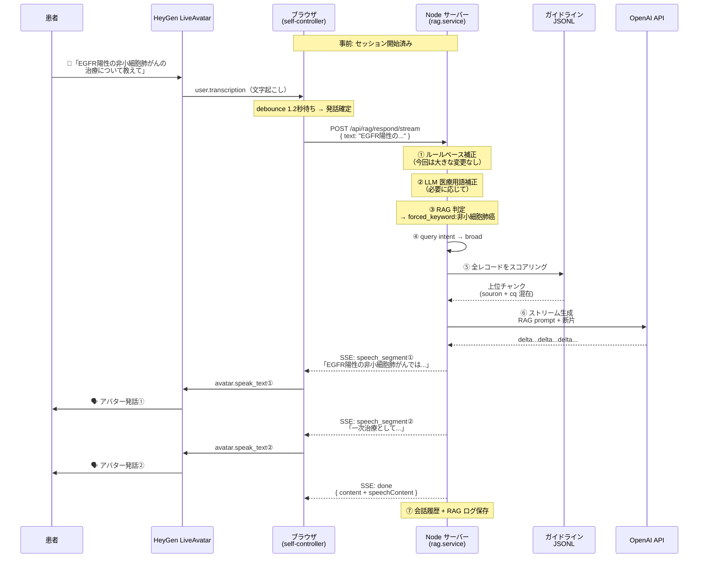
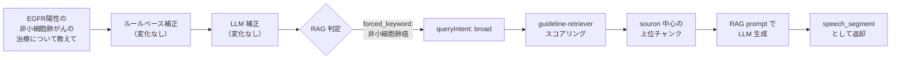

# EGFR Query Trace

このファイルは、`EGFR陽性の非小細胞肺がんの治療について教えて` という 1 問を例に、標準構成の処理を実装順に追うためのトレースです。`LIVEAVATAR_SELF_CONTROLLED=true` を前提にしています。

## 処理トレース例: `EGFR陽性の非小細胞肺がんの治療について教えて`

以下のシーケンス図は、この 1 問が最初から最後まで流れる全体像です。各ステップの詳細はその後のセクションで説明します。



### 0. 事前にセッションはどう始まっているか

ユーザーがその質問をする前に、`Start Session` を押した段階で次が済んでいます。

1. `public/app.js`
   - デバッグ UI では `public/app.js`、表示寄り UI では `public/xgate.js` が同じ起動フローを使います
   - `createLiveAvatarSessionToken()` で `POST /api/liveavatar/session-token`
   - `startLiveAvatarSession()` で `POST /api/liveavatar/start-session`
   - LiveKit に接続
   - self-controlled 用に `createSelfControlledConversation()` を初期化
   - `bindRagSession()` で `POST /api/rag/session` を呼び、サーバー側の会話セッションとデバッグ用 session binding を初期化する
   - `startOpeningGreeting()` で opening greeting を `avatar.speak_text` として読み上げ開始する
2. `src/features/liveavatar/liveavatar.controller.js`
   - ブラウザからの API 呼び出しを受ける
3. `src/features/liveavatar/liveavatar.service.js`
   - LiveAvatar API に対して session token 作成と session start を実行する

ここまで終わると、ブラウザは「アバター映像を受け取れる状態」「LiveAvatar からのイベントを受け取れる状態」になり、RAG 側にもその `sessionId` で会話履歴の入れ物が作られています。

### 1. ユーザーが話す

ユーザーがマイクに向かって `EGFR陽性の非小細胞肺がんの治療について教えて` と話します。

すると LiveAvatar 側で音声が文字起こしされ、`agent-response` topic のイベントとしてブラウザへ届きます。

この受信処理は `public/liveavatar-session-events.js` の `createLiveAvatarDataHandler()` が担い、`public/app.js` と `public/xgate.js` の両方から使われます。

- topic が `agent-response` ならイベント JSON を読む
- self-controlled が有効なら `public/liveavatar-self-controller.js` の `handleAgentResponseEvent()` に渡す
- `event_type === "user.transcription"` なら `enqueueUserTranscript()` に入る

### 2. 文字起こしを少し待ってまとめる

音声認識は細かく分割されることがあるので、受け取った瞬間に毎回 RAG を呼ぶわけではありません。

`public/liveavatar-self-controller.js` では次のことをしています。

- `bufferedTranscripts` に一時的にためる
- `LIVEAVATAR_TRANSCRIPT_DEBOUNCE_MS` ミリ秒だけ待つ
- 追加の発話が来なければ `flushBufferedTranscripts()` を呼ぶ

つまり、ユーザーが一文しゃべり終わったと判断できたタイミングで、まとめて RAG に送ります。

### 3. ブラウザが RAG API を呼ぶ

まとまった文字列は `public/liveavatar-self-controller.js` から `respondToTextStream()` 経由で、各 UI から共通利用されるハンドラに渡されます。実際の HTTP 呼び出し本体は `public/liveavatar-browser-api.js` の `respondWithRagStream()` です。

ここでブラウザは次を呼びます。

```text
POST /api/rag/respond/stream
{
  "sessionId": "...",
  "text": "EGFR陽性の非小細胞肺がんの治療について教えて"
}
```

レスポンスは JSON 一発返しではなく、SSE で `speech_segment` を複数回流し、最後に `done` で最終結果を返します。

### 4. サーバーの入口で受ける

この API は次の順で入ります。

1. `src/features/rag/rag.routes.js`
   - `POST /api/rag/respond` と `POST /api/rag/respond/stream` を定義
2. `src/features/rag/rag.controller.js`
   - 標準経路では `postRespondWithRagStream()` が `text` と `sessionId` を取り出す
   - `src/features/rag/rag.service.js` の `streamChatCompletion()` を呼ぶ

ここから本格的に RAG の本処理に入ります。

### 5. 会話履歴を読み、発話を正規化する



`src/features/rag/rag.service.js` では、共通処理の中心は `buildAnswerResult()` です。標準経路ではこれを `streamChatCompletion()` から呼びます。

まず次のことをします。

- `sessionId` を決める
- `src/features/rag/conversation.store.js` から会話履歴を読む
- `src/features/rag/transcript-normalizer.js` の `normalizeMedicalTranscript()` でルールベース補正をかける
- `src/features/rag/llm-transcript-normalizer.js` で、肺がん関連の医療用語だけを LLM で再補正する

今回の発話は比較的きれいなので、大きな補正なしでそのまま近い形になります。

```text
rawText: EGFR陽性の非小細胞肺がんの治療について教えて
normalizedText: EGFR陽性の非小細胞肺がんの治療について教えて
```

もし音声認識が崩れていても、ここで医療用語の誤変換を直します。現在はまずルールベースで次のような補正を入れています。

- `1日治療` -> `一次治療`
- `ハイリスク分` -> `ハイリスク群`
- `背門部` -> `肺門部`
- `予防的全能照射` / `予防的全能消者` -> `予防的全脳照射`
- `進められる` / `進め合える` -> `勧められる`
- `占領` -> `線量`
- 症状文脈での `席` -> `咳`

そのうえで、ルールで取り切れない崩れについては LLM に「肺がん関連の医療用語だけを直す」役を持たせています。回答はさせず、補正結果の JSON だけを返させています。

### 6. この質問は RAG が必要か判定する

次に `src/features/rag/rag-router.js` の `decideNeedRag()` を通します。

この判定では、たとえば次を見ています。

- `EGFR`
- `非小細胞肺癌`
- `一次治療` や `治療`
- `肺がん` 文脈

今回の質問は医学用語が明確なので、`needsRag: true` になります。実際に現在の実装でこの文字列を通すと、`reason` は `forced_keyword:非小細胞肺癌` になります。

逆に `こんにちは` のような発話なら、ここで `needsRag: false` となり、検索せず通常会話ルートに流れます。

### 7. 検索クエリを作る

RAG が必要と判定されたら、`src/features/rag/follow-up-context.js` の `buildRetrievalQuery()` で検索用クエリを組みます（`rag.service.js` から import して呼ばれます）。

今回の質問はそれ自体で十分具体的なので、ほぼそのまま検索語になります。

```text
EGFR陽性の非小細胞肺がんの治療について教えて
```

会話の続きで `それって一次治療ですか？` のような短文だった場合は、ここで直近 4 メッセージを見て検索語を補います。`assistant` 側の返答文も、`EGFR` `ラジアル型EBUS` のような医療アンカーを含んでいれば混ざります。

### 8. JSONL を検索して候補を集める

次に `src/features/rag/retrievers/guideline-retriever.js` の `retrieveGuidelineChunks()` が呼ばれます。

ここで行うことは次です。

1. 初回検索時だけ `data/processed/lung-cancer-guideline-hybrid.jsonl` を読み込み、その後はメモリ上のキャッシュを使う
2. 各行を 1 レコードとしてパースする
3. `src/features/rag/query-normalizer.js` で質問を正規化し、句・語・タグ候補を作る
4. 質問を `specific / broad / meta` のどれに近いか判定する
5. 各レコードに対して exact match、phrase match、tag match、文字 n-gram 類似度、source prior を使ってスコア計算する
6. `cq / souron / meta` ごとに quota を持たせて strict 候補を優先しつつ上位 `RAG_TOP_K` 件まで返す

今回の質問は `一次治療` や `病期` を明示していないかなり広い聞き方なので、現在の実装では `queryIntent: "broad"` になります。そのため、先頭は CQ よりも `souron` に寄りやすく、たとえば次のような総論断片が先に来ます。

- `souron`
  - `周術期における治療方針 - 2） 術前および術後補助薬物療法： BQ1 ， CQ24a-c ， CQ25～30`
- `souron`
  - `Ⅲ期非小細胞肺癌・肺尖部胸壁浸潤癌における治療方針 - 1） Ⅲ期非小細胞肺癌における治療方針`
- `cq`
  - `CQ6 cN2非小細胞肺癌の治療方針は，呼吸器外科医，内科医，放射線治療医を含めた集学的治療グループで検討すべきか？`

このとき `matchedTerms` も `egfr` だけではなく、`systemic-therapy` `perioperative` `radiation` `非小細胞肺癌` `治療方針` のような broad query 向けの語が前面に出ます。つまり、「EGFR の個別薬剤選択」というより、「肺がん治療の全体像」に寄った断片群が先に集まり、その中から上位 `RAG_TOP_K` 件が採用されます。

### 9. 取得した断片だけを根拠に LLM へ渡す

候補が 0 件でなければ、`src/features/rag/prompts/answer-prompt.js` を使って RAG 用の system prompt と context を組みます。

ここではざっくり次の情報が LLM に渡されます。

- あなたは肺がん専門の内科医 `山本` として話すこと
- 患者向けに平易な日本語で答えること
- 検索結果にない内容を断定しないこと
- 会話履歴より取得した断片を優先すること
- `recommendation` と `explanation` を先に見て、断片にない薬剤名・比較・条件・数値は補わないこと
- 短い追質問なら、直近の会話履歴も一部 user/assistant メッセージとして渡すこと
- 取得したガイドライン断片の `rank` `relevanceScore` `chapter` `section` `title` `cq` `question` `recommendation` `recommendationStrength` `evidenceGrade` `explanation` `updatedAt` `url`

そのうえで `src/features/rag/rag.service.js` は、標準経路では `callUpstreamOpenAiStream()` を使って OpenAI API を stream モードで呼びます。

### 10. サーバーが返答文とログを作る

LLM の返答を受けながら、`src/features/rag/rag.service.js` は次を行います。

- `content`
  - 最終的に出典一覧付きのテキストを作る
- `speechContent`
  - 実際にアバターへ読ませる短めの本文を作る
- `speech_segment`
  - 文の切れ目ごとに読み上げ向けテキストを前倒しで切り出す
- `src/features/rag/speech-pronunciation.js`
  - `EGFR` などを読み上げやすい表現に変える
- `src/features/rag/streaming-speech.js`
  - 句読点単位で `speech_segment` を flush する
- `src/features/rag/rag-log.store.js`
  - `rag_hit`、`matchedTerms`、`topHits`、`similarity` などをログ保存する
- `src/features/rag/conversation.store.js`
  - 今回の会話を履歴に保存する

コントローラからブラウザに返る標準経路のレスポンスは、SSE でだいたい次の流れになります。

```text
event: speech_segment
data: {"text":"EGFR陽性の非小細胞肺がんでは...","speechText":"EGFR陽性の非小細胞肺がんでは...","subtitleText":"EGFR陽性の非小細胞肺がんでは..."}

event: speech_segment
data: {"text":"一次治療として...","speechText":"一次治療として...","subtitleText":"一次治療として..."}

event: done
data: {"ok":true,"content":"患者向け回答本文 ...\n\n出典:\n1. ...","speechContent":"患者向け回答本文 ..."}
```

### 11. ブラウザがアバターに読ませる

このレスポンスを受けると、`public/liveavatar-self-controller.js` の `onSpeechSegment()` 経由で、`speech_segment` ごとに `queueSpeech()` が呼ばれます。

`queueSpeech()` は内部キューを経由して `agent-control` topic に次のようなイベントを publish します。

```json
{
  "event_type": "avatar.speak_text",
  "text": "EGFR陽性の非小細胞肺がんでは..."
}
```

これにより、LiveAvatar がその文を音声付きで話します。

途中でユーザーが話し直した場合は、同じファイルの `cancelCurrentResponse()` が進行中の stream を abort し、`avatar.interrupt` を送って発話を止めます。

### 12. 開発 UI では何が見えるか

デバッグ画面 `/index.html` を見ていると、今回の質問でだいたい次が確認できます。

- Runtime Log
  - `user.transcription.final: ...`
  - `avatar.speak_text: ...`
  - `RAG answer { content: ... }`
- RAG Log
  - `kind: rag_hit`
  - `routeReason: forced_keyword:非小細胞肺癌`
  - `retrievalStage: strict`
  - `matchedTerms: ["systemic-therapy", "perioperative", "非小細胞肺癌", ...]`
  - `topHits: [...]`

つまり、今回の質問 1 回だけでも次の流れが全部観測できます。

1. 音声が文字になる
2. RAG 対象か判定される
3. JSONL が検索される
4. LLM が回答文を作る
5. アバターがその文を話す
