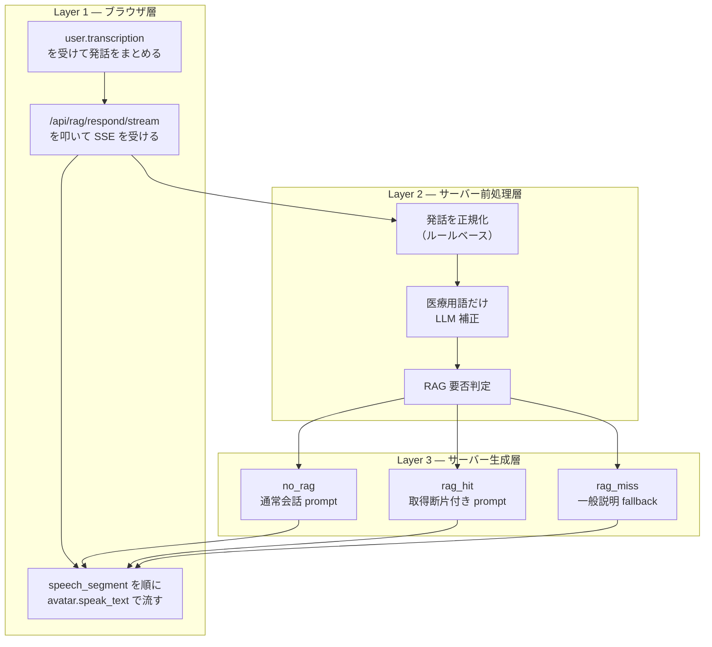
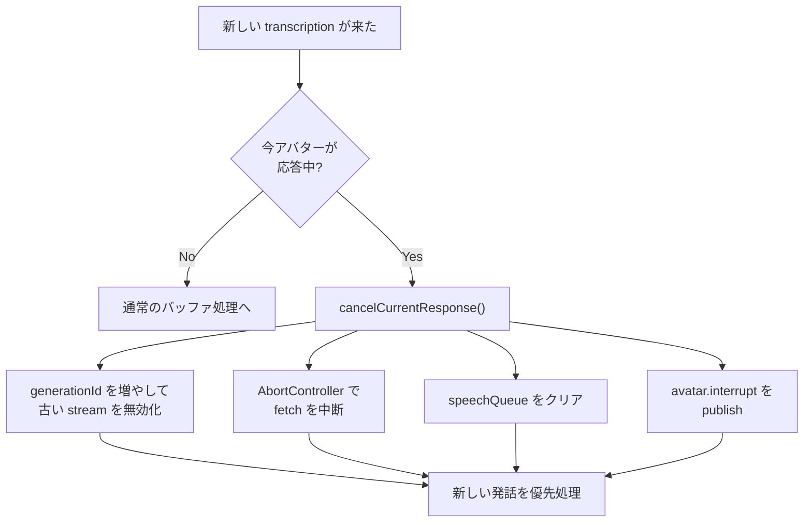
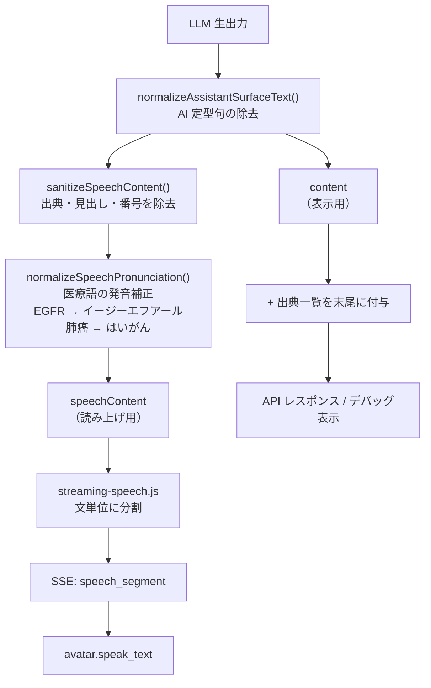
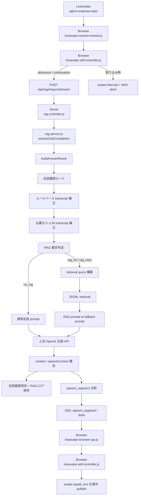

# LLM Workflow

このファイルは、「今この repo で LLM がどこで呼ばれ、どう前処理され、最終的に何がアバターへ読まれるか」を処理順に追うための詳細ドキュメントです。標準構成である `LIVEAVATAR_SELF_CONTROLLED=true` を前提にしています。

## 現在の LLM 処理ワークフロー

まず最短で言うと、現在の 1 ターンは次の 3 層に分かれます。



1. ブラウザ層
   - `user.transcription` を受けて発話をまとめる
   - `/api/rag/respond/stream` を叩いて SSE を受ける
   - `speech_segment` を順に `avatar.speak_text` でアバターへ流す
2. サーバー前処理層
   - 発話を正規化する
   - 必要なら医療用語だけ LLM で補正する
   - RAG が必要かどうかを決める
3. サーバー生成層
   - `no_rag` なら通常会話 prompt で LLM 応答
   - `rag_hit` なら取得断片付き prompt で LLM 応答
   - `rag_miss` なら「ガイドライン外の点は一般論で補う」fallback prompt で LLM 応答

### 0. 今どこで LLM を呼んでいるか

現在の標準経路で LLM を呼ぶ場所は 2 か所です。

1. `rag.service.js` の `maybeNormalizeTranscriptWithLlm()`
   - 役割は「音声認識の医療用語補正」です
   - 回答生成はしません
   - `RAG_LLM_TRANSCRIPT_NORMALIZATION_ENABLED=true` かつ `OPENAI_API_KEY` があるときだけ動きます
2. 同じく `rag.service.js` の `generateAssistantContent()`
   - 役割は「最終回答文の生成」です
   - `no_rag` `rag_hit` `rag_miss` のいずれでも、最終的な自然文はここで上流 LLM に書かせます

現在の回答スタイルは、3 分岐とも次を基本にしています。

- 最初に短い相づちや受け止めを入れる
- その直後に結論を先に言う
- 理由や補足は 1〜2 点だけ足す
- ガイドラインに足りない点でも、まず答えを簡潔に述べ、一般的に言える補足を短く添える
- `ガイドラインでは明記されていませんが` は定型句にせず、根拠の線引きが重要なときだけ短く触れる
- `主治医に相談してください` は毎回答えの締めに入れない
- `今回いただいた情報では` `この取得結果からは` のような AI っぽい言い回しは避ける

さらに今は、prompt で禁止するだけではなく、生成後にも後処理を入れています。つまり「LLM がたまたま禁句を出したらそのまま表示される」状態ではありません。

- `speech-content.js` の `normalizeAssistantSurfaceText()`
  - `今回いただいた情報では` `今いただいている情報では` `現時点の情報では` `現在の情報では` `今の情報では`
  - `この取得結果からは` `取得結果からは`
  - `情報が足りないため` `情報が限られているため`
  - `ガイドラインでは明記されていませんが、一般的には` → `一般的には` に短縮
  - `○○情報には含まれていませんが` `○○情報にはありませんが` → 読点に置換
  - これらの裏側を匂わせる定型句を `BACKSTAGE_STYLE_RULES` 配列で機械的に除去・短縮します（全パターンは `speech-content.js` 参照）
- `rag.service.js`
  - `no_rag` `rag_hit` `rag_miss` の全分岐で、LLM 生出力をいったん `normalizeAssistantSurfaceText()` に通してから `content` と `speechContent` を組み立てます

そのため、今の実装は「prompt で抑える」「出力後にも表層を整える」の二段構えです。

逆に、現在の標準経路で LLM を使っていない場所は次です。

- ガイドライン検索そのもの
  - `guideline-retriever.js` のルールベース検索です
- RAG 要否判定
  - `rag-router.js` のルールベースです
- 追質問判定
  - `follow-up-context.js` のルールベースです
- `speech_segment` への分割
  - `streaming-speech.js` の句読点ベースです

つまり、今の実装は「検索やルーティングは deterministic に寄せ、自然文の補正と生成だけ LLM に任せる」という設計です。

## 1. ブラウザで `user.transcription` を受ける

LiveAvatar からの data event は `public/liveavatar-session-events.js` の `createLiveAvatarDataHandler()` が受けます。ここで topic が `agent-response` のイベントだけを見るようになっています。

標準構成では `liveAvatarConfig.selfControlled` が `true` なので、`event.event_type === "user.transcription"` の payload は `public/liveavatar-self-controller.js` の `handleAgentResponseEvent()` に渡されます。

このときブラウザは、受けた transcription を即座に 1 回ごと送信しているわけではありません。いったんバッファします。

- `bufferedTranscripts`
  - 途中で届く transcription 断片をためる配列です
- `debounceMs`
  - 既定値は `LIVEAVATAR_TRANSCRIPT_DEBOUNCE_MS=1200`
  - 1.2 秒程度の静けさを待ってから 1 発話として確定します
- `flushPollMs`
  - 既定値 250ms ごとに「まだユーザーが話しているか」を再確認します
- `continuationWindowMs`
  - 既定値は `LIVEAVATAR_TRANSCRIPT_CONTINUATION_MS=1800`
  - 前回発話が途中で切れていた場合、短時間ならその続きとして連結します

ここで重要なのは、現在の会話制御の主導権がブラウザ側にあることです。サーバーは「確定した 1 発話」を受けるだけで、その前の transcription の寄せ集めや中断処理はブラウザが担っています。

## 2. 既存応答があればブラウザが割り込む



`public/liveavatar-self-controller.js` の `enqueueUserTranscript()` は、新しい transcription が来た時点で `hasActiveResponse()` を見ます。

もし次のどれかが残っていれば、ブラウザは今の応答を止めます。

- サーバーへの生成リクエストが進行中
- アバターがいま話している
- まだ送っていない `speechQueue` が残っている
- `pendingSpeechSegment` がある

止めるときは `cancelCurrentResponse()` が動き、次をまとめて行います。

- `generationId` を増やして古い stream を無効化
- `AbortController` で `/api/rag/respond/stream` を中断
- キュー済み音声を消す
- 画面上に残っている self-controlled 字幕を即時クリアする
- `avatar.interrupt` を `agent-control` topic に publish
- 直後に届く古い `avatar.speak_started` / 終了 event を新しい応答へ誤結合しないよう、短い interrupt grace window を置く

つまり、途中で患者が話し始めたら「古い回答を最後までしゃべらせず、新しい発話を優先する」実装です。

## 3. 発話確定後に `/api/rag/respond/stream` を呼ぶ

十分な無音が入ると `public/liveavatar-self-controller.js` の `flushBufferedTranscripts()` が走り、結合済みテキストを `respondToTextStream()` に渡します。

`createSelfControlledSession()` でこの関数は `public/liveavatar-browser-api.js` の `respondWithRagStream()` に結線されています。

ブラウザからサーバーへ送る body はかなり単純です。

```json
{
  "sessionId": "<currentSessionId>",
  "text": "<確定した患者発話>"
}
```

この endpoint は `POST /api/rag/respond/stream` です。返却は JSON ではなく SSE で、主に次の event を返します。

- `speech_segment`
  - 読み上げ可能になった 1 文ぶん
- `done`
  - 最終的な `content` と `speechContent`
- `error`
  - 失敗時

## 4. サーバー入口で SSE を張る

`rag.controller.js` の `postRespondWithRagStream()` が `/api/rag/respond/stream` の入口です。

ここでは最初に次を行います。

- `text` が文字列か検証
- `AbortController` を作成
- クライアント切断時に `abortController.abort()` するよう `res.on("close")` を登録
- `Content-Type: text/event-stream` など SSE 用 header を設定

その後、`streamChatCompletion()` を呼びます。`streamChatCompletion()` には `onSpeechSegment(segment)` という callback を渡しており、ここで 1 文ごとに `event: speech_segment` を書き出します。

つまり、`/api/rag/respond/stream` 自体は「LLM を直接 stream している」というより、「内部の回答生成結果を文単位に切って SSE 化して返す薄い controller」です。

## 5. `streamChatCompletion()` が文単位 flush を管理する

`rag.service.js` の `streamChatCompletion()` は、内部では `buildAnswerResult()` を呼びつつ、`onContentDelta` を渡しています。

流れは次です。

1. 上流 LLM から delta が来る
2. `pendingSpeechBuffer` に追記する
3. `streaming-speech.js` の `pullCompletedSpeechSegments()` で、`。！？?!` を境界に完全文だけ抜く
4. 抜けた文を順に `onSpeechSegment()` へ流す
5. 最後に端数が残れば `flushSpeechSegment()` で 1 回 flush する
6. もし 1 文も区切れなかった場合は、最後に `result.speechContent` 全体を 1 回だけ送る

ここでのポイントは、「上流 LLM の token stream をそのままブラウザへ転送しているわけではない」ことです。今の実装はあくまで「話せる単位の文」に整えてから返しています。

## 6. `buildAnswerResult()` が LLM 処理全体の中核

実際の分岐や前処理は、ほぼ全部 `rag.service.js` の `buildAnswerResult()` に入っています。ここが現在の LLM 処理フローの本体です。

この関数の最初の入力は次です。

- `body.messages`
  - OpenAI 互換形式の message 配列
- `body.metadata.sessionId`
  - 会話セッション ID

`/api/rag/respond/stream` から来た場合は controller 側で

```json
{
  "messages": [{ "role": "user", "content": "<text>" }],
  "metadata": {
    "sessionId": "<sessionId>"
  }
}
```

に組み替えてから入るイメージです。

## 7. 会話履歴はどう読み込まれるか

会話履歴は DB ではなくメモリ保持です。`maybeLoadConversation(sessionId)` は `conversation.store.js` を呼びます。

ここでの挙動は次です。

- 対象 session がまだなければ新規作成する
- 初回だけ `LIVEAVATAR_OPENING_GREETING` を assistant message として注入する
- 保持件数は `RAG_CONVERSATION_HISTORY_LIMIT` 件までに切る

この履歴は 3 つの用途で使われます。

1. LLM による医療用語補正の文脈
2. 追質問判定と検索クエリ拡張
3. `no_rag` や follow-up 会話時の prompt 文脈

## 8. まずルールベースで transcript を補正する

最初の前処理は `transcript-normalizer.js` の `normalizeMedicalTranscript()` です。

ここでやっているのは、医療・呼吸器文脈で起こりやすい誤変換の最小修正です。たとえば次があります。

- `ハイリスク分 -> ハイリスク群`
- `背門部 -> 肺門部`
- `対岸について教えてください -> 肺がんについて教えてください`
- `席が出る -> 咳が出る`
- `1日治療 -> 一次治療`
- `全能照射 -> 全脳照射`
- `進められる占領 -> 勧められる線量`

また、履歴側に咳や痰の文脈があるときだけ `席です -> 咳です` にするような文脈依存補正もあります。

出力は単なる文字列ではなく、次のような構造です。

- `rawText`
- `normalizedText`
- `repairs`
- `changed`

## 9. 必要なら医療用語だけ LLM で補正する

次に `maybeNormalizeTranscriptWithLlm()` が走ります。これは常時ではありません。次の両方を満たしたときだけです。

- `RAG_LLM_TRANSCRIPT_NORMALIZATION_ENABLED=true`
- `OPENAI_API_KEY` が設定されている

このとき `llm-transcript-normalizer.js` の `buildMedicalTranscriptNormalizationMessages()` が、専用の system/user prompt を作ります。

特徴は次です。

- 肺がん診療会話専用の「補正器」として振る舞わせる
- 回答生成は禁止
- 新しい症状や薬剤名を足すのは禁止
- 出力は JSON `{ "normalizedText": "..." }` のみ
- 直近 4 メッセージぶんの会話文脈も渡す
- ルールベース補正候補も一緒に渡す

実際の上流 call は `rag.service.js` の `callUpstreamOpenAi()` で、ここでは温度 0、モデルは `RAG_LLM_TRANSCRIPT_NORMALIZATION_MODEL` を使います。

返り値は `parseMedicalTranscriptNormalizationResponse()` で JSON 抽出されます。フェンス付き JSON や、余計な前置きが付いた JSON でもできるだけ本体だけ取り出す実装です。もし parse 失敗しても、元の候補に戻します。つまりここは best effort です。

## 10. RAG を使うかどうかをルールで決める

次に `rag-router.js` の `decideNeedRag()` が、最終 transcript を見て `route` を返します。

返り値は次の形です。

```json
{
  "needsRag": true,
  "reason": "forced_keyword:非小細胞肺癌"
}
```

判定順は大きく次です。

1. 空文字なら `needsRag: false`
2. `CQ14` のような CQ 番号があれば強制的に RAG
3. `EGFR` `ALK` `病期` `一次治療` `予防的全脳照射` `緩和ケア` `外科治療` `診断` など約 30 個の強制キーワードのいずれかがあれば RAG
4. `肺がん` / `肺癌` 文脈と、`診断|治療|病期|ステージ|推奨|ガイドライン|副作用|再発|転移|方針|概要|流れ|考え方|緩和ケア` のいずれかが同時にあれば RAG
5. 挨拶や接続確認なら `smalltalk_or_control` で no_rag
6. 追質問っぽい短文なら、直近 4 メッセージ込みでもう一度 2〜4 の医療シグナルを見る

なお、`rag.service.js` では `decideNeedRag` をルールベース補正後と LLM 補正後の 2 回呼びます。初回はLLM 補正を試みるかの判定に使い、最終判定で実際の検索分岐を決めます。

ここでは LLM を使いません。判定理由は `routeReason` としてそのままログに残ります。

## 11. 分岐ごとの生成

- `RAG_ENABLED=false`
  - 固定メッセージを返し、`kind: "rag_disabled"` としてログに積みます
- `route.needsRag === false`
  - `buildConversationSystemPrompt()` を使う通常会話ルートです
- `route.needsRag === true` かつ `topHits.length === 0`
  - `rag_miss` として一般説明 fallback prompt に切り替えます
- `route.needsRag === true` かつ `topHits.length > 0`
  - `buildRagSystemPrompt()` と `buildRagContext()` を使う `rag_hit` です

## 12. 上流 LLM 呼び出しはまず stream を試す

`generateAssistantContent()` は、`onContentDelta` が渡されているとまず `callUpstreamOpenAiStream()` を使います。

この関数は次を行います。

- `POST ${OPENAI_API_BASE_URL}/chat/completions`
- `Authorization: Bearer ${OPENAI_API_KEY}`
- `model: OPENAI_MODEL`
- `stream: true`
- `messages: [...]`

返却された SSE を自前で読み、OpenAI 互換の `choices[0].delta.content` を抜いて `content` に連結していきます。

もし stream 呼び出しが失敗した場合、`generateAssistantContent()` は warning を出したうえで通常の非 stream call `callUpstreamOpenAi()` に fallback します。つまり、上流が stream 非対応でもこのアプリの応答自体は成立するようにしてあります。

## 13. `content` と `speechContent` を分ける



上流 LLM から返ってきた回答文は、まず `normalizeAssistantSurfaceText()` で AI 定型句を除去してから `content` と `speechContent` の基底になります。つまり API で返る `content` は LLM 生出力そのままではなく、正規化済みの文です。さらにアバターにそのまま読ませるわけでもありません。

`speech-content.js` では、まず `normalizeAssistantSurfaceText()` が回答表面を整えます。

- `今回いただいた情報では`
- `今いただいている情報では`
- `この取得結果からは`
- `情報が足りないため`

のような AI の裏側を感じさせる定型句を落とし、余計な読点や空白も整えます。

その後 `sanitizeSpeechContent()` が、読み上げ用に次を削ります。

- `出典:` 以降の全文
- `回答:` `根拠:` `注意:` のような見出し
- 箇条書き番号
- 余分な空白

さらに `speech-pronunciation.js` で医療語の読み上げ発音を整えます。この置換は `speechContent` にだけ適用し、RAG 検索 query や会話履歴には使いません。

このため最終的には、同じ 1 応答でも次の 2 系統が存在します。

- `content`
  - デバッグや API レスポンス向け
  - ただし LLM 生出力そのままではなく、AIっぽい定型句を落とした後の文です
  - `rag_hit` なら末尾に出典一覧が付く
- `speechContent`
  - アバター音声向け
  - 出典や見出しを除いた自然文だけ

## 14. 生成結果は必ずログと履歴に残る

分岐後、`buildAnswerResult()` は `appendRagLog()` と `persistConversation()` を呼びます。

ログには分岐に応じて次のような差があります。

- `no_rag`
  - `kind: "no_rag"`
  - `needsRag: false`
  - `routeReason`
  - `model`
- `rag_hit`
  - `kind: "rag_hit"`
  - `retrievalQuery`
  - `retrievalStage`
  - `matchedTerms`
  - `sourceIds`
  - `topHits`
  - `model`
- `rag_miss`
  - `kind: "rag_miss"`
  - `retrievalQuery`
  - `retrievalStage`
  - `fallbackMode: "general_llm"`

会話履歴に保存するのは `content` です。つまり次ターンの文脈には、出典一覧や読み上げ専用の発音補正を除いた、回答本文ベースの assistant 発話が残ります。

## 15. SSE の `speech_segment` をブラウザが speak queue に積む

サーバーから返された `speech_segment` は、`public/liveavatar-browser-api.js` の `respondWithRagStream()` が受けます。

この関数は SSE block を読み、`event:` と `data:` を parse して `onEvent({ type, data })` に渡します。

`public/liveavatar-session-events.js` の `createSelfControlledSession()` は、`event.type === "speech_segment"` のときだけ `speechText` と `subtitleText` を取り出して `onSpeechSegment(...)` に渡します。

すると `public/liveavatar-self-controller.js` 側では次が起こります。

- `queueSpeech(segment)` で `speechQueue` に積む
- すでに発話中でなければ `dispatchNextSpeech()` が動く
- `segment.speechText` を `avatar.speak_text` として `agent-control` topic に publish
- このとき browser 側で付与した `client_response_id` `client_generation_id` `client_segment_id` も一緒に送る
- 返ってくる `avatar.speak_started` / 終了 event に同じ ID があれば、それと一致する segment だけを採用する

publish payload は次です。

```json
{
  "event_type": "avatar.speak_text",
  "text": "<1文ぶんの speech_segment>",
  "client_generation_id": "<browser generation id>",
  "client_response_id": "<browser response id>",
  "client_segment_id": "<browser segment id>"
}
```

## 16. アバター発話イベントで次文へ進む

ブラウザは `avatar.speak_text` を投げたあと、LiveAvatar 側から返る `avatar.speak_started` や字幕終了系 event を待ちます。

`public/liveavatar-self-controller.js` の `handleAgentResponseEvent()` では次のように処理します。

- `avatar.speak_started`
  - `client_*` ID が一致する `pendingSpeechSegment` だけを確定し `isSpeaking=true` にする
  - 一致しない event や、interrupt 直後の古い event は無視する
  - 採用した `pendingSpeechSegment.subtitleText` を字幕表示に回す
- 字幕終了 event
  - `client_*` ID が一致する現在発話中 segment に対してだけ `isSpeaking=false` にする
  - queue が残っていれば次の `speech_segment` を送る
  - 残っていなければ `onSpeechIdle()` で字幕を消す

つまり、複数文の回答は「まとめて 1 回で読ませる」のではなく、「文単位に順番待ちさせて 1 文ずつ確実にアバターに話させる」流れです。

## 17. `/v1/chat/completions` も中身は同じ RAG 本体を使う

この repo には `POST /v1/chat/completions` もあります。入口は `rag.controller.js` の `postChatCompletions()` です。

ここは外形だけ OpenAI 互換です。中では次をします。

- 必要なら `RAG_ENDPOINT_API_KEY` で認証
- `messages` から最後の user message を取る
- `handleChatCompletion()` を呼ぶ
- 中で結局 `buildAnswerResult()` に入る
- 最後だけ `openai-chat-response.js` で OpenAI 互換 JSON に包む

つまり `/api/rag/respond/stream` と `/v1/chat/completions` は入口と出力形式が違うだけで、前処理、RAG 判定、検索、LLM 生成の中核ロジックは同一です。

## 18. 1 ターン全体を擬似シーケンスで書くとこうなる



## 19. 実装上の要点を 1 行ずつでまとめる

- 現在の標準構成では、LLM の呼び出し主体は LiveAvatar ではなくこの Node サーバーです
- LLM は「医療用語補正」と「最終自然文生成」にだけ使っています
- RAG 要否判定と検索はルールベースです
- 上流 stream に失敗しても非 stream call へ fallback します
- `content` は表示用、`speechContent` はアバター読み上げ用です
- 会話履歴には表示用の `content` が残り、`speechContent` は読み上げ専用です
- ブラウザが割り込み制御を持っているため、ユーザーが話し始めたら応答中でも止められます
