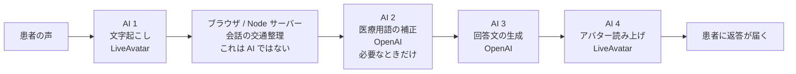
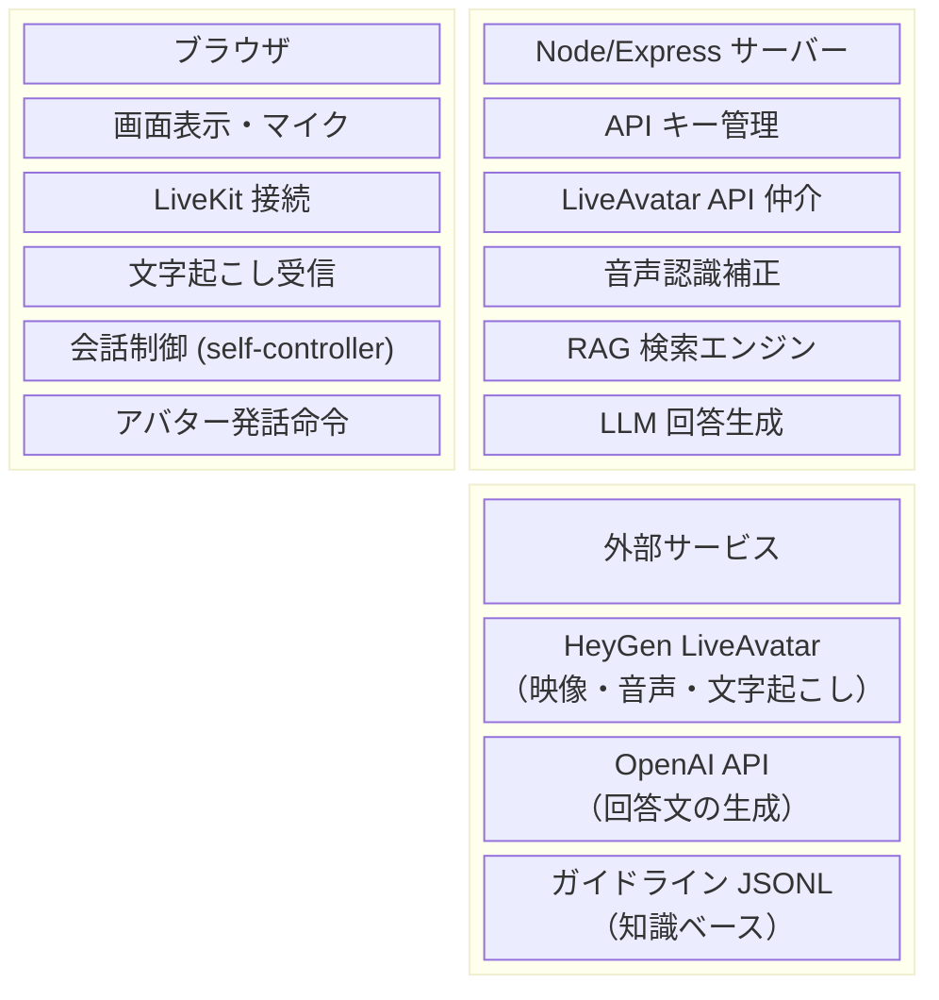
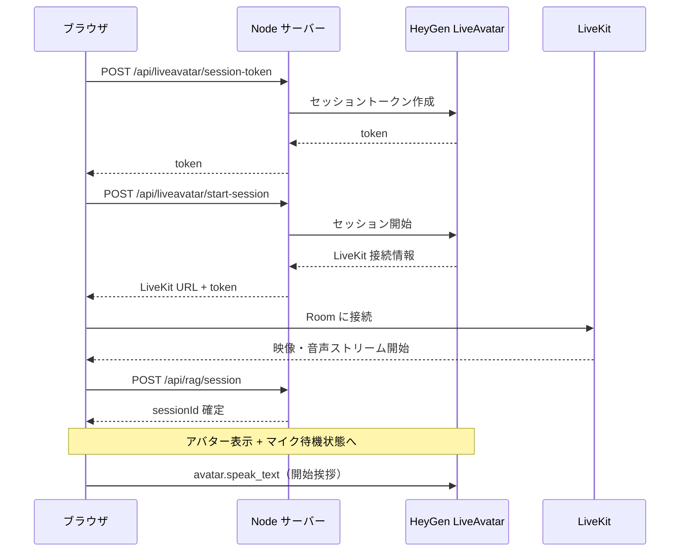
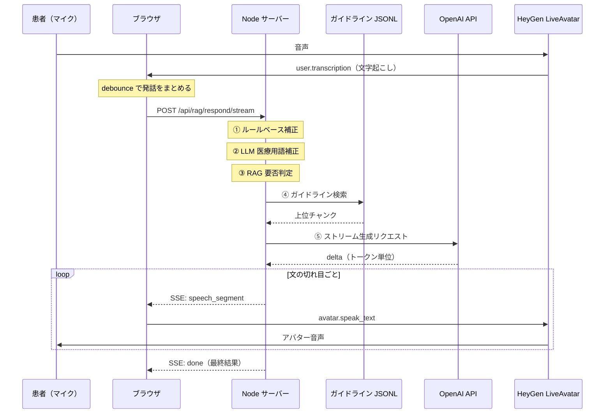

# Overview

このファイルは、「このアプリは今どう動いているか」を最短で掴むための概要ドキュメントです。初見の人はまずここを読むと、README 本体から詳細に潜る前に全体像を掴みやすくなります。

## 今の実装を一言でいうと

- ブラウザが LiveAvatar セッションを開始し、LiveKit で映像・音声を受ける
- `user.transcription` をブラウザで受け取り、発話がまとまったタイミングで `/api/rag/respond/stream` に投げる
- サーバーが JSONL 形式の肺がんガイドラインを検索し、OpenAI API で回答文を生成しながら SSE で音声向け文を段階返却する
- ブラウザが `speech_segment` を受けて `avatar.speak_text` を `agent-control` topic に publish し、必要なら `avatar.interrupt` も送る

---

## まず用語だけ先に

- LiveAvatar
  - HeyGen のリアルタイム会話アバター機能です
  - このアプリでは「見た目のアバターを表示する」「ユーザーの音声を受ける」「アバター音声を再生する」役を担当します
- LiveKit
  - ブラウザとアバターの間で、映像と音声をリアルタイム送受信するための仕組みです
  - ざっくり言うと「ビデオ通話の土台」に近いです
- transcription
  - 音声の文字起こしです
  - ここでは、ユーザーが話した内容を LiveAvatar 側がテキスト化してブラウザに送ってきます
- self-controlled
  - アバターの返答文を LiveAvatar に任せず、こちらのアプリ側で作る方式です
  - 今の標準構成はこれです
- RAG
  - 先に手元データを検索し、その検索結果を根拠として LLM に回答文を書かせるやり方です
  - この repo では `data/processed/lung-cancer-guideline-hybrid.jsonl` を検索対象にしています
  - 現在の中身は、2025 CQ 137 件と 2024 の `souron` 34 件 + `meta` 5 件を混在させた hybrid JSONL です
- topic
  - リアルタイム通信で使う「チャンネル名」くらいに考えれば十分です
  - `agent-response` はアバター側から来るイベント、`agent-control` はこちらから送る制御命令に使っています
- publish
  - topic に向けてイベントを送ることです
  - このアプリでは `avatar.speak_text` を publish して、アバターにその文を読ませます

---

## AI の役割分担

初見だと「どの AI が何をしているのか」が一番分かりにくいので、先に役割だけ切り分けると次です。

- AI 1
  - LiveAvatar 側の文字起こし担当です
  - 患者の音声をテキストにします
- AI 2
  - OpenAI 側の医療用語補正担当です
  - `全能照射` のような崩れを `全脳照射` に直す役です
  - 必要なときだけ動きます
- AI 3
  - OpenAI 側の回答文生成担当です
  - ガイドライン検索結果を見ながら説明文を作ります
- AI 4
  - LiveAvatar 側の読み上げ担当です
  - 作られた文章をアバター音声で読みます

補足:

- AI 2 と AI 3 は、どちらも OpenAI 系ですが役割は別です
- ブラウザと Node サーバーは、各担当へ入力を渡して結果をつなぐ制御役です
- つまり今の標準構成は「文字起こし AI」「補正 AI」「回答生成 AI」「読み上げ AI」の分担型です

---

## このアプリで何がどこまで担当しているか

- ブラウザ
  - 画面表示、マイク許可、LiveKit 接続、文字起こしイベント受信、アバターへの発話命令送信を担当します
- Node/Express サーバー
  - API キーを隠したまま LiveAvatar API を呼び、RAG で回答文を作ります
- OpenAI API
  - 検索されたガイドライン断片をもとに、患者向けの自然な説明文を生成します
- ガイドライン JSONL
  - RAG の検索対象です
  - いわば「このアプリが参照する知識ベース」です

---

## 重要な前提

- 現在の README 上の標準運用は `LIVEAVATAR_SELF_CONTROLLED=true` です
  - つまり、LiveAvatar は「アバター表示 + 音声入出力 + transcription」を担当し、回答本文の生成はこのサーバー側が担当します
  - さらに実際の会話制御はブラウザ側にあり、文字起こしをまとめて RAG に送り、返ってきた `speech_segment` をアバターに読ませています
- ただしコード上の既定値は `LIVEAVATAR_SELF_CONTROLLED=false` です
  - 標準構成で動かすなら `.env` か `.env.example` 側で `LIVEAVATAR_SELF_CONTROLLED=true` を明示します
- 今の標準経路では `OPENAI_API_KEY` は実質必須です
  - RAG 対象の質問でも雑談でも、最終的な返答文の生成はサーバー側から OpenAI 互換 `chat/completions` を呼びます
  - `OPENAI_API_KEY` がない場合、医療用語の LLM 補正は自動でスキップされますが、回答生成自体は失敗します
- `LIVEAVATAR_MODE` は今も使っています
  - コード上のデフォルト値は `FULL` で、LiveAvatar のセッショントークン作成時に API へ渡しています
  - ただし、今の標準経路では `LIVEAVATAR_SELF_CONTROLLED=true` のため、`FULL` であっても回答本文の生成は LiveAvatar 側ではなくこのサーバー側の RAG が行います
  - つまり `LIVEAVATAR_MODE` は「今の標準構成で会話本文を誰が作るか」を切り替える主スイッチではなく、その役割は `LIVEAVATAR_SELF_CONTROLLED` 側にあります
- `LIVEAVATAR_AVATAR_ID` はコード上では既定の avatar ID を持っています
  - `.env.example` にも動作確認用の avatar ID を入れています
  - 利用するアバターを変更したい場合は、`.env` 側で上書きしてください
- 標準の self-controlled 経路では `LIVEAVATAR_CONTEXT_ID` と `LIVEAVATAR_LLM_CONFIGURATION_ID` は使いません
  - これらが必要になるのは、self-controlled をやめて LiveAvatar 側の built-in 会話や custom LLM を使う場合だけです
- 検索はベクトル検索ではありません
  - `data/processed/lung-cancer-guideline-hybrid.jsonl` を対象に、`cq` `souron` `meta` の 3 種類の断片へルールベース検索をかけています
  - `title` `heading` `question` `recommendation` `explanation` `tags` などへの一致と、2-gram / 3-gram 類似度を組み合わせてスコア付けしています
  - 具体質問では CQ を上位に出しやすくし、広い説明質問では総論 `souron` を先頭に寄せつつ全体を総論寄りにし、略語や補助情報の質問では `meta` を先頭に出しやすくする設計です
- 音声認識テキストの補正は二段構えです
  - まず `src/features/rag/transcript-normalizer.js` のルールベース補正を行います
  - その後、`RAG_LLM_TRANSCRIPT_NORMALIZATION_ENABLED=true` かつ `OPENAI_API_KEY` がある場合だけ、`src/features/rag/llm-transcript-normalizer.js` の LLM 補正を追加します
  - LLM 補正を試みるかどうかは `shouldAttemptLlmTranscriptNormalization()` が判定します
    - ルールベース補正で変化があった場合、初回 RAG 判定で `needsRag` の場合、または履歴ありの追質問の場合に試みます
    - それ以外（雑談と判定されて補正も不要な場合）はスキップされます
- RAG 要否の判定は、ルール補正後と LLM 補正後の 2 回行われます
  - 初回はルールベース補正後のテキストで行い、LLM 補正の要否判定に使います
  - 最終判定は LLM 補正後（またはスキップ後）のテキストで行い、実際の検索処理に使います
- 新規質問か追質問かの判定は、主に `src/features/rag/follow-up-context.js` で行っています
  - この repo には `new_question=true` のような専用フラグはなく、実質的には「`isLikelyFollowUpUtterance()` が `false` なら新規質問寄り」と考えるのが近いです
  - 単独で意味が立つ具体的な質問は、新規質問として扱われやすいです
    - 例: `EGFR陽性の非小細胞肺がんの一次治療は？`
  - `それ` `今の` `続き` `詳しく` のような前の文脈を前提にした短い言い方は、追質問として扱われやすいです
    - 例: `それって術後も同じですか？`
  - ただし現在も短文は追質問寄りに扱われやすく、24文字未満の短文は候補になりやすいです
    - 一方で `ALKは？` のように短くても独立した医療アンカーがある質問は、新規質問として扱うようにしています
  - 新規質問として扱われた場合は、RAG 検索語に過去会話を足さず、今回の発話を中心に検索します
  - 追質問として扱われた場合は、直近の会話から文脈を足して検索語を組みます
  - 実際にその切り替えを使っている本体は `src/features/rag/rag.service.js` で、`src/features/rag/follow-up-context.js` の `buildRetrievalQuery()` と `src/features/rag/prompts/answer-prompt.js` の `buildRagSystemPrompt()` を通じて検索とプロンプトへ反映しています
- 会話履歴と RAG ログはメモリ保持のみです
  - `src/features/rag/conversation.store.js` と `src/features/rag/rag-log.store.js` でプロセス内に保持しているだけで、永続化はしていません
  - サーバー再起動で消えます

---

## 技術スタック

- Node.js 20
- Express
- LiveKit browser client
- HeyGen LiveAvatar HTTP API
- OpenAI Chat Completions API 互換呼び出し
- Docker / Docker Compose

---

## 起動の全体像

### セッション開始（初期化フロー）

### 1 問の会話フロー

もっと平たく言うと、処理の流れは次です。

1. ブラウザがアバター会話を始める
2. ユーザーが話す
3. LiveAvatar がその音声を文字にする
4. その文字をサーバーの RAG にストリーミングで渡す
5. サーバーがガイドラインを検索して回答文を作りつつ、話せる文単位で返す
6. ブラウザがその文ごとにアバターへ読ませる
