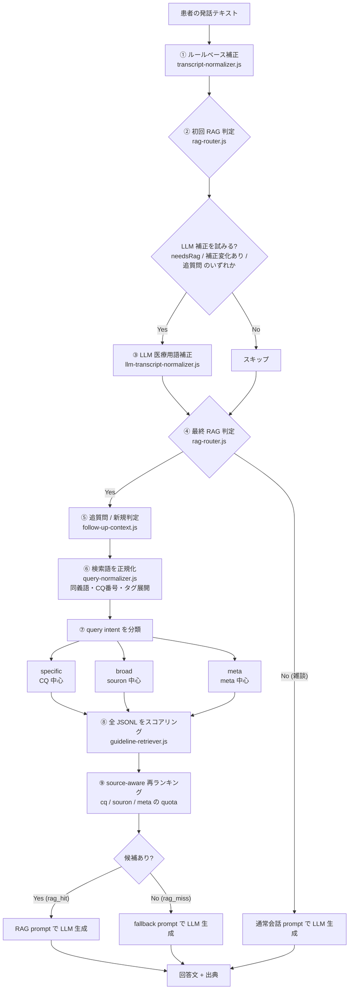
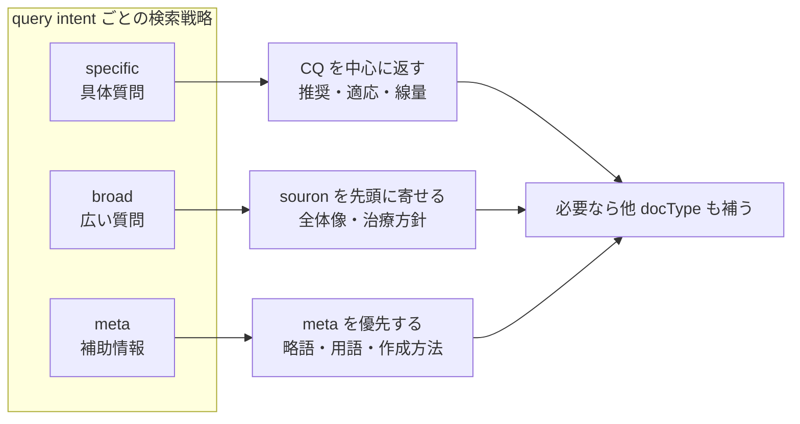
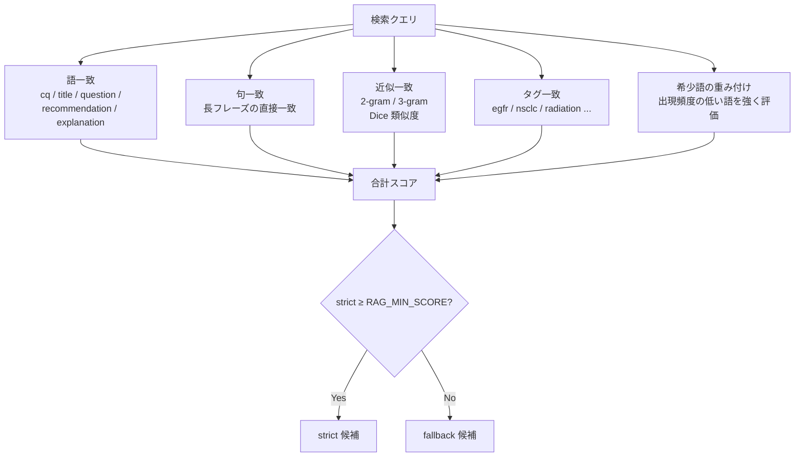
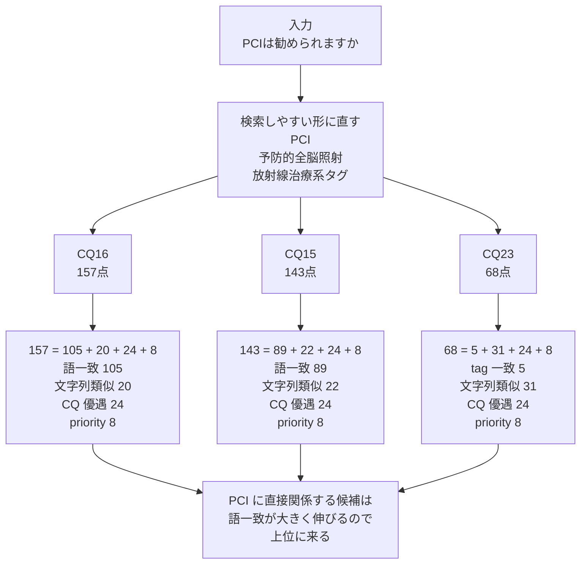
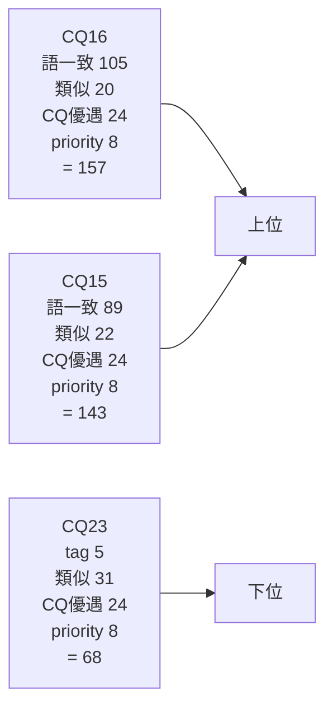

# RAG Deep Dive

このファイルは、現在の RAG 実装だけを深く理解したい人向けの詳細ドキュメントです。検索アルゴリズム、intent 判定、スコアリング、具体例、ログの読み方までをまとめています。

## 今の RAG はどう動くか

今の RAG は、ベクトル DB や embedding index を使う方式ではありません。`data/processed/lung-cancer-guideline-hybrid.jsonl` を 1 行 1 レコードの JSONL として読み込み、質問と各レコードの文字列を直接見比べてスコアを付ける方式です。データは最初の検索時に読み込まれ、その後はプロセス内にキャッシュされます。

先に 1 行で言うと、今の実装は次です。

`音声認識補正 -> 必要なら医療用語だけ LLM 補正 -> RAG が必要か判定 -> query intent を specific / broad / meta に分類 -> cq / souron / meta を source-aware に再ランキング -> 上位断片だけを根拠に LLM で返答生成`



### なぜ今この方式を選んでいるか

- 検索対象が有限で管理しやすい
  - 現在の対象は `lung-cancer-guideline-hybrid.jsonl` という 1 つの加工済みデータです
  - 中身は 2025 の CQ と 2024 の `souron` / `meta` を混在させた構成です
  - 1 行が `cq` `souron` `meta` のいずれか 1 断片なので、検索対象の単位が明確です
- 文書の役割が最初から違うので、役割を分けたほうが安定する
  - `cq` は推奨・適応・線量のような狭く具体的な質問に強いです
  - `souron` は全体像、治療方針、考え方の説明に強いです
  - `meta` は略語、用語、文献検索法、採択方法のような補助質問に強いです
  - これらを 1 つの同じ順位表で雑に競わせるより、query intent ごとに quota と優先度を分けたほうが、返答の役割分担が崩れにくいです
- デバッグしやすい
  - `matchedTerms` `similarity` `retrievalStage` `sourceIds` がそのままログに残るので、なぜその断片が拾われたか追いやすいです
  - ベクトル検索より、ヒット理由を画面やログで説明しやすいです
- 医療系デモとして「なぜそれを根拠に答えたか」を説明しやすい
  - たとえば `PCIは勧められますか` なら、`PCI -> 予防的全脳照射` に展開され、`CQ14/15/16` が上位に来たとログで追えます
  - たとえば `肺がん治療について教えてください` なら、broad intent と判定されて `souron` が優先されたことをそのまま確認できます
- 音声認識ゆらぎに対して段階的に対処しやすい
  - まずルールベース補正、その後必要なら医療用語だけ LLM 補正という二段構えです
  - いきなり embedding に投げるより、医療用語の取り違えを前段で潰しやすいです
- 運用が軽い
  - embedding 生成ジョブ、ベクトル DB、再 indexing の仕組みが要りません
  - この demo のように検索対象が限定されている段階では、構成をかなり単純に保てます
- 回答を「取得断片ベース」に寄せやすい
  - 今の prompt は、会話履歴や一般知識よりも取得断片を優先するようかなり強く制約しています
- 2025 CQ と 2024 総論を一緒に使う都合にも合っている
  - いま手元で安定して取り込めているのは、2025 の CQ と 2024 ページ群の `souron` / `meta` です
  - CQ と総論を同じ `docType` に潰さず、`cq/souron/meta` として保持しておくほうが、混在年次でも「この断片は推奨なのか、総論なのか、補助情報なのか」を明示できます

要するに、今は「大規模検索のための仕組み」よりも、「肺がんガイドラインの限られたデータを安定して拾い、理由まで説明できること」を優先した実装です。

### 検索対象の実体

JSONL は「1 行ごとに 1 個の JSON オブジェクトが入っているテキストファイル」です。この repo では 1 行がガイドラインの 1 断片に対応し、`docType` で役割を分けています。現在の `lung-cancer-guideline-hybrid.jsonl` は、2025 の CQ 行と 2024 の `souron` / `meta` 行を 1 つにまとめたファイルです。

- `cq`
  - 推奨・適応・線量・有用性のような具体質問向け
- `souron`
  - 総論や解説の段落単位。全体像や方針の説明向け
- `meta`
  - 略語、文献検索法、採択方法などの補助情報

1 行のイメージは次です。

```json
{
  "id": "lcg-hybrid-...",
  "docType": "souron",
  "chapter": "Ⅰ．肺癌の診断",
  "section": "肺癌の診断（病理・細胞診断の総論は後述）",
  "heading": "肺癌の診断（病理・細胞診断の総論は後述）",
  "subheading": "2）質的画像診断",
  "title": "肺癌の診断（病理・細胞診断の総論は後述） - 2）質的画像診断",
  "question": "2）質的画像診断",
  "recommendation": "検診などのスクリーニング検査や臨床症状によって撮影された胸部X線で肺癌を疑う所見を得た場合...",
  "explanation": "...",
  "tags": ["lung-cancer", "diagnosis"]
}
```

実データは `data/processed/lung-cancer-guideline-hybrid.jsonl` にあり、検索時は `src/features/rag/retrievers/guideline-retriever.js` がこれを読み込んで保持します。

README の例では主要フィールドだけを抜いていますが、実レコードには `version` `part` `url` `updatedAt` `sourceType` `hasTable` `hasFigure` `relatedCqs` `priority` なども入っています。

### 実際の流れ

RAG の主処理は `src/features/rag/rag.service.js` に集まっています。流れは次です。

1. `transcript-normalizer.js` で、よくある音声認識崩れをルールベースで補正する
2. ルールベース補正後のテキストで `rag-router.js` の初回判定を行う（LLM 補正を試みるかの判断に使う）
3. 初回判定で `needsRag` / ルール補正で変化あり / 履歴ありの追質問のいずれかなら、`llm-transcript-normalizer.js` で肺がん関連の医療用語だけを LLM で再補正する（それ以外はスキップ）
4. LLM 補正後（またはスキップ後）のテキストで `rag-router.js` の最終判定を行う
5. RAG 対象なら、短い追質問のときは直近 4 メッセージを見て検索クエリを作る
6. `query-normalizer.js` で、CQ 番号、同義語、略語、タグ対応を展開しつつ検索語を正規化する
7. 各 JSONL レコードに対してスコアを計算する
8. query intent を `specific / broad / meta` に分け、`cq / souron / meta` ごとに quota を持って再ランキングする
9. strict 候補を優先しながら `RAG_TOP_K` 件まで選ぶ
10. 候補があれば、その断片だけを根拠に OpenAI に回答文を書かせる
11. 候補がなければ、一般説明 fallback prompt に切り替えて回答を続ける

重要なのは、質問文をいきなり 1 回の LLM に丸投げしていないことです。前段を分けています。

- 入力の音声認識補正
  - `transcript-normalizer.js` のルールベースです
  - 例: `ハイリスク分 -> ハイリスク群`、`背門部 -> 肺門部`、`全能照射 -> 全脳照射`
- 医療用語の再補正
  - `llm-transcript-normalizer.js` の LLM 補正です
  - `RAG_LLM_TRANSCRIPT_NORMALIZATION_ENABLED=true` かつ `OPENAI_API_KEY` がある場合だけ動きます
  - ルールベース候補と会話文脈を渡し、肺がん関連の医学用語だけを低温度で置き換えます
  - 回答生成はさせず、JSON `{ "normalizedText": "..." }` だけを返させています
- RAG 対象かのルーティング
  - `rag-router.js` のルールベースです
  - CQ 番号、強制キーワード、肺がん文脈 + 医療意図、短い追質問時の最近 4 メッセージ文脈を見ます
- LLM を使う場所
  - 医療用語補正
  - 検索後に、取得した断片だけを根拠として回答文を作る部分

ここで 1 点重要なのは、検索に使う語が `query-normalizer.js` の同義語辞書だけで決まるわけではないことです。

- `query-normalizer.js` は検索用の「足場」を作ります
- その中には、同義語辞書から展開した canonical 語やタグ語だけでなく、入力文そのものから切り出した語や CQ 番号も入ります
- さらに retriever 側では、入力全文を詰めた文字列から 2-gram / 3-gram を作って類似度も見ています

つまり、「辞書に書かれている語しか検索に使われない」ではなく、「辞書展開に加えて、入力文から抽出した語と全文類似も一緒に使っている」が正確です。

## 具体例で見る



### 1. 具体質問: CQ を直接当てにいく

入力例:

```text
PCIは勧められますか
```

このときの流れ:

1. `query-normalizer.js` が `PCI -> 予防的全脳照射` に展開する
2. `rag-router.js` は `forced_keyword:予防的全脳照射` と判定して `needsRag: true` にする
3. `retrieveGuidelineChunks()` は `specific` intent として扱う
4. 上位候補は PCI 関連の CQ に寄る

テストで固定している期待値は次です。

- 上位 3 件は `CQ14` `CQ15` `CQ16` のいずれかになる
  - 実装テストでは「この 3 件が集合として入ること」を確認しています
  - 現在の手元データでは `CQ16 -> CQ14 -> CQ15` の順で出ることがあります

ここで重要なのは、質問が短くても `PCI` を canonical 語へ展開できるため、単なる「勧められるか」という広い言い方に引っ張られにくいことです。

### 2. 広い質問: broad intent として扱う

入力例:

```text
肺がん治療について教えてください
```

このときの流れ:

1. `query-normalizer.js` が `肺がん治療` を見て、`薬物療法` `放射線治療` `外科治療` `術前治療` `術後補助療法` などを追加する
2. `retrieveGuidelineChunks()` は `queryIntent: broad` と判定する
3. `cq / souron / meta` を source-aware に再ランキングする
4. broad query では `souron` を優先し、先頭は `souron` に寄せる
5. そのうえで必要なら関連する CQ を足す

つまり broad intent は「常に CQ を混ぜる」でも「総論だけ返す」でもありません。実装の狙いは「広い質問ではまず総論から全体像を作り、必要なときだけ CQ で具体性を足す」ことです。

今の実装で `肺がん治療について教えてください` を流すと、現在の hybrid JSONL では実際に次のような `souron` が上位に来ます。

- `souron`
  - `周術期における治療方針`
- `souron`
  - `Ⅲ期非小細胞肺癌・肺尖部胸壁浸潤癌における治療方針 - 1） Ⅲ期非小細胞肺癌における治療方針`
- `souron`
  - `小細胞肺癌の治療方針 - 1） 限局型小細胞肺癌（LD）`
- `souron`
  - `肺癌に対する外科治療`

この例では `topK=4` の 4 件すべてが `souron` です。つまり現在の broad retrieval は、README の以前の説明よりも総論寄りです。質問が広いほど、まず総論で骨格を作るほうに倒しています。

### 3. 追質問: 直前の文脈を検索語に足す

会話例:

```text
user: 肺末梢小型病変の経気管支生検に仮想気管支鏡ナビゲーションは勧められますか
assistant: ...
user: ガイドライン見てくれよ 一回
```

この最後の発話だけを見ると意味が薄いので、`buildRetrievalQuery()` は直前文脈を足して、実際には次のような検索語を作ります。

```text
肺末梢小型病変の経気管支生検に仮想気管支鏡ナビゲーションは勧められますか
ガイドライン見てくれよ 一回
```

この結果、テストでは `CQ12` が最上位になります。短い追質問でも前の話題を失わないためです。

もう 1 つ重要なのは、現在の実装では assistant 側の発話も条件付きで retrieval query に混ざることです。混ざるのは「assistant 発話に医療アンカーがある場合だけ」です。

会話例:

```text
user: 症病変の景気監視整形にラジアル型EBUFは進められますか
assistant: 経気管支鏡検査でのラジアル型EBUSのことですね。現在、どのような症状や検査結果があって、その検査を検討されているのでしょうか？
user: 検診で影があり詳しく調べる予定です
```

このとき `buildRetrievalQuery()` は、実際には次の 3 行を連結します。

```text
症病変の景気監視整形にラジアル型EBUFは進められますか
経気管支鏡検査でのラジアル型EBUSのことですね。現在、どのような症状や検査結果があって、その検査を検討されているのでしょうか？
検診で影があり詳しく調べる予定です
```

つまり今の README で「直近の user 発話だけを足す」「assistant は混ぜない」と読むのは不正確です。正しくは次です。

- 直近 4 メッセージを見る
- user 発話はそのまま候補にする
- assistant 発話は、医療アンカーがあるものだけ候補にする
- それらと現在発話を重複除去して連結する

### 4. 音声認識が崩れた質問: 補正してから検索する

入力例:

```text
予防的全能消者の進められる占領は何ですか
```

まず `transcript-normalizer.js` が次のように直します。

```text
予防的全脳照射の勧められる線量は何ですか
```

そのうえで retrieval に入るので、テストでは `CQ15` が最上位になります。ここで補正していなければ、`全能消者` `占領` のような崩れた語のせいで検索精度がかなり落ちます。

### 5. meta intent の質問: 補助情報寄りとして扱う

入力例:

```text
外科治療の略語を教えてください
```

この質問は `queryIntent: meta` になります。つまり実装上は「推奨や適応そのものより、略語・用語・作成方法のような補助情報を聞いている」とみなします。

現在の hybrid JSONL では、この質問に対して実際に `meta` が先頭に来ます。たとえば上位 4 件は次のとおりです。

- `meta`
  - `肺癌に対する外科治療 - 本文中に用いた略語および用語の解説`
- `meta`
  - `肺癌の診断（病理・細胞診断の総論は後述） - 本文中に用いた略語および用語の解説（病理・細胞診断の略語は後述）`
- `meta`
  - `小細胞肺癌の治療方針 - 本文中に用いた略語および用語の解説`
- `souron`
  - `肺癌に対する外科治療`

つまり今の README で「meta はまだ薄くて CQ が先に出ることがある」とだけ書くのは不正確でした。正しくは次です。

- `meta` intent では `meta` をかなり強く優先する
- 現在の略語質問では、実際に `meta` が先頭に来る
- ただし `meta` の総数自体は 5 断片しかないので、カバー範囲はまだ狭い
- 略語以外の編集方針や方法論の質問では、`souron` が補助的に混ざることがある

### 6. ログで見ると何が分かるか

`/api/rag/logs` や画面の `RAG Log` を見ると、だいたい次のような情報が出ます。

```text
[2026-03-14T12:34:56.000Z] rag_hit
needsRag: true
routeReason: forced_keyword:予防的全脳照射
queryIntent: specific
retrievalStage: strict
matchedTerms: ["予防的全脳照射","pci","radiation","sclc"]
sourceIds: ["lcg2025-...-cq14","lcg2025-...-cq15","lcg2025-...-cq16"]
```

このログを見ると、少なくとも次はすぐ分かります。

- そもそも RAG に入ったか
- 何が引き金で RAG 判定になったか
- `specific / broad / meta` のどれとして処理されたか
- どの `docType` の断片が実際に採用されたか
- どの語が一致して、その結果どの source が残ったか

## 初見の人は何を見ればよいか

RAG 周りを最短で理解したいなら、まず 1 問ぶんを次の順で見るのが一番早いです。

1. ユーザー質問
   - 例: `肺がん治療について教えてください`
2. `routeReason`
   - なぜ RAG に入ったかを見る
   - この例なら `forced_keyword:肺がん` と出ます
3. `queryIntent`
   - `specific` なら CQ 中心、`broad` なら `souron` 中心、`meta` なら `meta` 中心だと読めます
4. `topHits`
   - ここで `docType` と `title` を見る
   - broad 質問なのに `cq` だらけなら、総論寄りにしたいのかを再検討する材料になります
5. 最終 answer
   - どの断片が実際の説明文に使われたかを確認する

言い換えると、初見で読むときは「検索アルゴリズム全体」を先に理解しようとしなくて大丈夫です。`routeReason -> queryIntent -> topHits -> answer` の 4 点だけ追えば、挙動の大枠はかなり見えます。

## スコアはどう付けているか



現在は単純な全文一致ではなく、複数の要素を足し合わせています。

- 語一致
  - `cq` 完全一致
  - `title` `question` `recommendation` `section` `chapter` `explanation` への部分一致
- 句一致
  - ある程度長いフレーズが `title` や `question` にそのまま含まれるかを見ます
- 近似一致
  - 文字 2-gram / 3-gram ベースで `title` `question` `title+question` との Dice 類似度を計算します
- 希少語の重み付け
  - 多くのレコードに出る一般語より、出現頻度の低い語を強く評価します
- タグ一致
  - `egfr` `nsclc` `diagnosis` `radiation` のようなタグも使います
  - ただし全体の半分超に出る広すぎるタグは過大評価しません

つまり今の検索は、「同じ単語があるか」だけではなく、「長めのフレーズが近いか」「文字列として似ているか」「その語がそのテーマに特有か」まで見ています。

### 具体的な入力で見るとこうなる

抽象図だけだと分かりにくいので、`PCIは勧められますか` を例に「どこで何点くらい付くか」を実際の数値で見ると次のイメージです。

以下は、現在の `lung-cancer-guideline-hybrid.jsonl` と今の scoring ロジックで取れた実スコア例です。データや重みを変えると数値は変わりますが、「どう足し算されるか」を追うにはこの見方が一番分かりやすいです。



この図で見てほしいポイントは 3 つです。

1. 入力はそのまま探されるのではなく、まず `PCI` を `予防的全脳照射` のような検索語に言い換えて探す
2. 点は 1 か所で決まるのではなく、`語一致` `文字列類似` `CQ優遇` `priority` の合算で決まる
3. 関係が薄い `CQ23` も 68 点は付きますが、PCI に直接関係する候補は `語一致` の点が大きいので差が開く

言い換えると、今の scoring は「正解に 1 本釣りで当てる」より、「関連する根拠群に複数の加点が重なって自然に上へ上がる」作りです。

### `157点` の中身をさらに分解すると

`CQ16` の `157点` は、さらに次のように分かれます。

```text
157点
= 語一致 105
  = 予防的全脳照射 が title に入る 32
  + 予防的全脳照射 が question に入る 28
  + 予防的全脳照射 が recommendation に入る 16
  + 予防的全脳照射 が section/chapter に入る 8
  + 予防的全脳照射 が explanation に入る 4
  + PCI が section/chapter に入る 8
  + PCI が explanation に入る 4
  + radiation tag が付いている 5
+ 文字列類似 20
+ specific 質問なので CQ を優遇 24
+ priority 8
```

つまり `CQ16` が強い理由は、単に「PCI が入っているから」ではありません。

- `予防的全脳照射` が `title` と `question` に両方入っている
- `recommendation` にも同じ話題が出てくる
- `PCI` という略語も `section` や `explanation` に出てくる
- `radiation` tag も付いている
- そのうえで、specific 質問なので `cq` 自体に 24 点の優遇が入る

というふうに、加点源が何段も重なっています。

### 3候補を表で見ると



`CQ23` は `PCI` そのものとは関係ありませんが、`放射線治療` 系なので tag と文字列類似だけである程度点が付きます。逆に言うと、今の scoring は「少し似ている候補を 0 点にはしない」作りです。そのうえで、直接関係する候補は `語一致` が大きく伸びるので勝ちます。

ここでは `specific` 質問なので `CQ` に 24 点の優遇が付きます。`broad` 質問ならここが `souron` 優先寄りに変わりますし、`meta` 質問なら `meta` 優先寄りに変わります。

### 2-gram / 3-gram 類似って何か

ここは計算っぽく見えますが、やっていることはかなり素朴です。

- 2-gram
  - 文字列を 2 文字ずつに区切って比べる方法です
- 3-gram
  - 文字列を 3 文字ずつに区切って比べる方法です

たとえば `予防的全脳照射` なら、ざっくり次のように分けます。

- 2-gram: `予防` `防的` `的全` `全脳` `脳照` `照射`
- 3-gram: `予防的` `防的全` `的全脳` `全脳照` `脳照射`

これを質問文と候補レコードの `title` や `question` でそれぞれ作って、「どれだけ同じ断片が重なっているか」を見ます。

たとえば、質問が `予防的全脳照射の線量は？` で、候補の title が `予防的全脳照射の勧められる線量は何か？` なら、`予防` `防的` `全脳` `脳照` `照射` や `予防的` `的全脳` `全脳照` `脳照射` などがかなり重なります。なので「完全に同じ文ではないが、かなり近い文字列だ」と判断しやすくなります。

逆に、候補の title が `EGFR遺伝子変異陽性例の一次治療は？` なら、こうした文字断片の重なりはかなり少ないので、近似一致の点は低くなります。

要するに、2-gram / 3-gram 類似は「単語が完全一致しなくても、文字の並びがかなり近ければ拾いやすくするための仕組み」です。音声認識の揺れや、少し言い換えた質問に強くするために入っています。

### strict と fallback

検索結果には `retrievalStage` が付きます。

- `strict`
  - strong な一致条件を満たす候補が十分にある状態です
  - 実装上は、基本的に `score >= RAG_MIN_SCORE` かつ `matchedTerms.length > 0` か `similarity.titleQuestion >= 0.2` の候補が中心です
  - ただし broad query の `souron` と meta query の `meta` は special case で、`score >= RAG_MIN_SCORE` なら strict 候補に入れます
- `fallback`
  - 候補自体はあるが、strict 候補だけでは足りず、弱い一致や近似一致も混ぜて埋めている状態です
- `no_hit`
  - 候補が見つからなかった状態です

たとえば broad query で `souron` の `matchedTerms` が少なくても、`docType` prior や broad treatment intent の補正で十分に点が乗っていれば strict 側に残ります。今の broad retrieval が総論寄りに見えるのは、この special case も効いているためです。

## 具体例: `PCIは勧められますか` で何を拾ってくるか

抽象論だけだと分かりにくいので、RAG 部分だけに絞って 1 例を追います。

1. 入力は `PCIは勧められますか`
2. `rag-router.js` では、`PCI` が `query-normalizer.js` の同義語辞書で `予防的全脳照射` に対応しているため、`forced_keyword:予防的全脳照射` として RAG 対象になります
3. `query-normalizer.js` では、`PCI` から次のような検索の足場を作ります
   - canonical 語: `予防的全脳照射`
   - 元の語: `pci`
   - タグ語: `radiation` `sclc`
   - さらに stopword の `勧められ` は検索語から落とします
4. `guideline-retriever.js` は、全 JSONL レコードに対して `title` `question` `recommendation` `tags` などを見て点数を付けます
5. `PCI` そのものより、展開後の `予防的全脳照射` と `radiation` `sclc` が効くため、PCI 関連の CQ が上位に寄ります
6. 実際の回帰テストでは、上位 3 件に `CQ14` `CQ15` `CQ16` が含まれることを確認しています

この例のポイントは、「PCI という略語をそのまま文字一致で探しているだけではない」ことです。実際には、略語を canonical 語の `予防的全脳照射` とタグ語の `radiation` `sclc` に展開してから、`title` `question` `recommendation` `tags` など複数の欄に対してスコアを付けています。そのため、質問が短くても PCI 周辺の CQ をまとまって拾いやすくなっています。さらに現在の hybrid JSONL では、上位 4 件目に PCI 関連の `souron` が続くことがあります。

なお、この挙動は README 上の説明だけではなく、`src/features/rag/rag-retrieval.test.js` の `retrieves PCI-specific CQs for a short PCI query without unrelated recommendation hits` でも確認しています。
