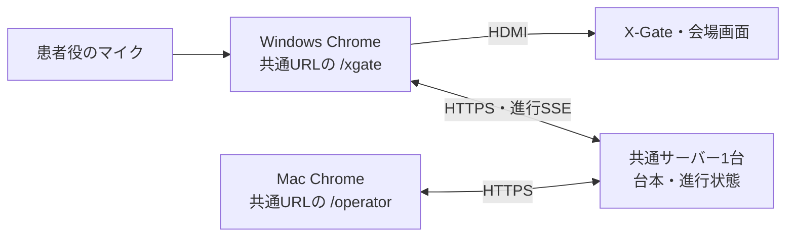

# Mac・Windowsで使うためのセットアップと運用

MacとWindowsのどちらでも、同じリポジトリを取得して起動できます。**別のWindows PCでも単体で使いたい場合は、そのWindowsにNode.js・Git・Chromeを入れ、Windows自身でサーバーを起動する方法**を使います。Macを起動しておく必要はありません。

これまでの資料は [READMEのセットアップ](../README.md#セットアップ) と [Mac向けのX-Gate接続手順](../X-GATE_connection.md) に分かれていました。この文書に、Windowsの初期設定、Macとのコード更新、2台で同じ進行を操作する場合の違いをまとめます。

## 1. 使い方を選ぶ

| 目的                                             | サーバーを動かす場所   | 各PCで開く画面                                          | 進行状態                                             |
| ------------------------------------------------ | ---------------------- | ------------------------------------------------------- | ---------------------------------------------------- |
| MacでもWindowsでも、それぞれ単体で使う           | 使用するPC自身         | そのPCの `http://localhost:3000/xgate` と `/operator`   | PCごとに独立                                         |
| Windowsにアバターを表示し、Macから進行を操作する | 共通のHTTPSサーバー1台 | Windowsは共通URLの `/xgate`、Macは同じURLの `/operator` | 同じサーバーの進行を操作                             |
| MacからWindowsへ本番用PCを切り替える             | 切り替え先のWindows    | Windowsの `http://localhost:3000/xgate` と `/operator`  | 自動移行しない。途中からなら「ジャンプ」で位置を指定 |

`localhost` は「そのブラウザが動いているPC自身」です。Windowsのブラウザで `http://localhost:3000` を開くと、Windows側のサーバーに接続します。

Gitで揃うのはコード・台本・読み仮名表です。`.env`、認証Cookie、会話の進行状態はGitでは共有されません。ローカル起動でもLiveAvatar・LiveKitなどへのインターネット接続は必要です。

## 2. 初回に用意するもの

| 項目               | 内容                                                                                                  |
| ------------------ | ----------------------------------------------------------------------------------------------------- |
| Node.js            | プロジェクトの最低要件は22.13.0。Dockerと揃えるなら22系の最新パッチを両PCに入れる                     |
| Git                | GitHubから取得・更新するために使用                                                                    |
| Google Chrome      | 会場画面・操作画面と、既存のブラウザテストに使用                                                      |
| GitHubへのアクセス | `Kohei-Arita/yamamoto-avatar-scenario` を取得できるアカウント。非公開の場合はリポジトリへの権限が必要 |
| LiveAvatarの設定   | APIキー、使用するアバターID・音声ID。現在のMacと同じアバターを使うなら設定値を揃える                  |
| OpenAI APIキー     | 意図分類の補助を使う標準設定では設定する。未設定でも起動するが、LLM分類は使われない                   |
| OPERATOR_TOKEN     | 会場画面・操作画面の認証用。起動時に必須                                                              |
| 音声機器           | 使用するPCに接続する患者役の専用マイクと、アバター音声の出力先                                        |

Node.jsは [公式ダウンロード](https://nodejs.org/en/download) で22系と使用するOSを選択します。WindowsではWindows Installer（`.msi`）を使います。2026-11-16時点で22系はLTSです。将来セットアップする場合は [公式リリース一覧](https://nodejs.org/en/about/previous-releases) でサポート状況を確認してください。

WindowsのGitは [Git for Windowsの公式案内](https://git-scm.com/install/windows)、MacのGitは [macOS向けの公式案内](https://git-scm.com/install/mac) を使います。インストール後はターミナル／PowerShellを開き直してください。

## 3. Windowsで初めて起動する

Windows 11のPowerShellを使う例です。コードを置きたい作業用フォルダーでPowerShellを開きます。コマンドは1行ずつ実行し、エラーが出たら解消してから次へ進んでください。

### インストールの確認

```powershell
node --version
npm.cmd --version
git --version
```

以降のWindows用コマンドでは `npm.cmd` を使います。PowerShellで `npm.ps1` の実行が禁止されている環境でも、スクリプト実行ポリシーを変更せずにnpmを呼び出せます。

### コードを取得する

現在の運用コードは **`feature/production-hardening` ブランチ**です。以下では、このブランチを指定して取得します。

```powershell
git clone --branch feature/production-hardening https://github.com/Kohei-Arita/yamamoto-avatar-scenario.git
Set-Location yamamoto-avatar-scenario
git branch --show-current
npm.cmd ci
Copy-Item .env.example .env
notepad .env
```

GitHubの認証を求められたら、リポジトリにアクセスできるアカウントで認証します。`git branch --show-current` の結果が `feature/production-hardening` であることを確認してください。

`Copy-Item` は新規取得時の初回だけです。既存の `.env` は上書きせず、次の「共通の環境設定」に従って値を入力します。保存するファイル名は `.env` のままにし、`.env.txt` にしないでください。

設定後、同じPowerShellで実行します。

```powershell
npm.cmd test
npm.cmd start
```

`Server listening on http://127.0.0.1:3000` と表示されれば起動しています。このPowerShellは使用中、開いたままにします。

## 4. Macで起動する

### このMacの既存フォルダーを使う場合

この作業環境では、コードは次の場所にあります。設定済みの `.env` をそのまま使います。

```bash
cd /Users/aritakohei/yamamoto-avatar-scenario
node --version
git branch --show-current
npm start
```

依存関係が未導入なら `npm ci` を先に実行します。GitHubから更新を取り込む場合は、後述の「コード・台本を更新する」を使います。

### 別のMacへ新規取得する場合

作業用フォルダーでターミナルを開きます。

```bash
git clone --branch feature/production-hardening https://github.com/Kohei-Arita/yamamoto-avatar-scenario.git
cd yamamoto-avatar-scenario
npm ci
cp .env.example .env
```

テキストエディターで `.env` を設定してから実行します。

```bash
npm test
npm start
```

通常の運用は `npm start` を使います。開発中の自動再起動が必要なときは `npm run dev` です。

## 5. 共通の環境設定

`.env.example` をコピーして作った `.env` を編集します。現在のMacの設定を引き継ぐ場合は、APIキー・アバターID・音声ID・音声速度などを安全な方法で確認して揃えてください。`.env` はGitの対象外なので、`git clone` や `git pull` では移りません。

| 設定                          | 入れる値・確認する内容                                                |
| ----------------------------- | --------------------------------------------------------------------- |
| `LIVEAVATAR_API_KEY`          | 使用するLiveAvatarアカウントのAPIキー。必須                           |
| `LIVEAVATAR_AVATAR_ID`        | そのアカウントで利用できるアバターID。Macと同じ見た目にするなら同じ値 |
| `LIVEAVATAR_VOICE_ID`         | Macと同じ声にするなら同じ値                                           |
| `OPENAI_API_KEY`              | 意図分類の補助に使用するキー                                          |
| `OPERATOR_TOKEN`              | 十分に長いランダム文字列。会場画面と操作画面で入力する値              |
| `LIVEAVATAR_OPENING_GREETING` | 台本の冒頭を使うため空欄                                              |

新しく `OPERATOR_TOKEN` を作る場合は、Mac・Windows共通で次を実行し、表示された値を `.env` に入れます。既存のトークンを使う場合は生成し直す必要はありません。

```text
node -e "console.log(require('node:crypto').randomBytes(32).toString('hex'))"
```

ローカル運用では、次の設定を確認します。他の項目は `.env.example` を基準にしてください。

```dotenv
HOST=127.0.0.1
PORT=3000
LIVEAVATAR_MODE=FULL
LIVEAVATAR_SELF_CONTROLLED=true
LIVEAVATAR_ALLOW_INTERRUPT=false
LIVEAVATAR_MICROPHONE_AUTO_GAIN_CONTROL=false
LIVEAVATAR_OPENING_GREETING=
SCENARIO_ID=haigan-2026
SCENARIO_DIR=./data/scenarios
SCENARIO_SPEECH_MODE=fixed
SCENARIO_INTENT_LLM=true
```

APIキーや `OPERATOR_TOKEN` を台本・README・GitHubへ書き込まず、ローカルの `.env` またはデプロイ先の環境変数に保存します。`node_modules` はPC間でコピーせず、それぞれのPCで `npm ci` から作ります。

## 6. ブラウザと音声を確認する

### 最初の確認

1. 使用するPCでサーバーを起動した状態にする。
2. Chromeで `http://localhost:3000/api/health` を開き、`"ok": true` を確認する。これはサーバーの起動確認で、LiveAvatarの接続確認は次の手順で行う。
3. `http://localhost:3000/operator` を開き、そのサーバーの `OPERATOR_TOKEN` で接続する。
4. 別タブで `http://localhost:3000/xgate` を開く。入場画面へ移ったら同じトークンを入力し、`Start` を押す。
5. Chromeのマイク使用を許可し、冒頭の挨拶が実際にスピーカーから聞こえることを確認する。
6. 「はい、よろしくお願いします」と返答し、次の症状確認へ進むことを確認する。

`localhost` と `127.0.0.1` はブラウザ上で別のサイトとして扱われるため、画面を開くURLは `http://localhost:3000` に揃えます。認証はブラウザごとに必要です。

### Windowsのマイク・音声出力

- 「設定 → プライバシーとセキュリティ → マイク」で、マイクへのアクセスとデスクトップアプリからの利用を許可する。OSの許可に加えてChrome側でもサイトのマイクを許可する。[Microsoftのマイク確認手順](https://support.microsoft.com/en-us/windows/hardware/drivers/fix-microphone-problems)
- 「設定 → システム → サウンド」とChromeのマイク設定で、専用マイクが選ばれていることを確認する。HDMI接続後はアバター音声の出力先も確認する。
- 「🔊 タップして音声を有効にする」が出たらクリックして解除する。

Macでは「システム設定 → プライバシーとセキュリティ → マイク」でChromeの利用許可を確認します。[Appleのマイク権限の案内](https://support.apple.com/guide/mac-help/mchla1b1e1fe/mac)

アバター音声を含むミキサー出力を、そのままマイク入力へ戻さない構成にします。詳しい機材確認は [リハーサル手順](rehearsal.md) を使ってください。

### X-Gate・外部モニターへ出す

アバターを動かすPCからHDMIで接続します。Windowsは `Windows + P` →「拡張」、Macはディスプレイ設定で拡張表示にして、会場用のChromeウィンドウを外部画面へ移します。Windowsの表示切り替えは [Microsoftの複数モニター手順](https://support.microsoft.com/en-us/windows/hardware/display-graphics/how-to-use-multiple-monitors-in-windows) を参照してください。

本番用URLは両OS共通です。初回確認用のセッションをStopしてから切り替えます。

```text
http://localhost:3000/xgate?autostart=1&controls=0&subtitles=1
```

同じPCで `/operator` を手元の画面に残し、会場画面はアプリのFullscreenボタンで全画面にします。詳細は [X-Gate接続手順](../X-GATE_connection.md) を参照してください。

終了するときは会場画面のStopを押してセッションを終了し、その後ターミナル／PowerShellで `Ctrl+C` を押します。

## 7. コード・台本を更新する

Macで編集・コミット・プッシュした後、Windows側でも更新を取り込みます。GitHubへプッシュするだけでは、起動中のローカルサーバーの内容は切り替わりません。

まず会場画面のStopを押し、サーバーを `Ctrl+C` で停止します。プロジェクトのフォルダーで `git status --short` を実行し、変更がある場合は内容を確認・保全してから更新してください。

Mac:

```bash
git status --short
git switch feature/production-hardening
git pull --ff-only
npm ci
npm test
git log -1 --oneline
npm start
```

Windows PowerShell:

```powershell
git status --short
git switch feature/production-hardening
git pull --ff-only
npm.cmd ci
npm.cmd test
git log -1 --oneline
npm.cmd start
```

各コマンドが成功してから次へ進みます。`git pull --ff-only` が失敗した場合は、ローカルの変更やブランチの分岐を確認し、強制リセットで消さないでください。

両PCの `git log -1 --oneline` のコミットIDが同じなら、同じコードを取得できています。既存の `.env` は保持し、新しく必要になった設定だけ `.env.example` と比較して追加します。

再起動後は会場画面・操作画面を再読み込みします。台本JSONはサーバー内にキャッシュされるため、台詞だけの修正でも再起動が必要です。進行状態はメモリにあるため、再起動や別PCへの切り替え後に途中から再開する場合は、操作画面の「ジャンプ」でノードを指定してください。

## 8. Windowsに表示してMacから操作したい場合

この使い方では、**両PCが同じHTTPSサーバーに接続する構成**にします。WindowsとMacでそれぞれ起動した `localhost` 同士は、同じ進行を操作できません。



表示役と操作役のOSを逆にすることもできます。マイクは `/xgate` を開いている表示側のPCに接続します。

### 既存のRender設定を使う場合

このリポジトリには [render.yaml](../render.yaml) と [Dockerfile](../Dockerfile) があります。共通サーバーを新しく用意するときの手順です。既存のデプロイURLがある場合は、そのサービスのブランチ・環境変数を確認して利用します。

1. RenderでGitHubアカウントを接続し、`New > Blueprint` からこのリポジトリを選ぶ。
2. ブランチに **`feature/production-hardening`**、Blueprintのパスに `render.yaml` を指定する。同じリポジトリのサービスは、`branch` 指定がなければBlueprintのブランチを使う。[Blueprint作成手順](https://render.com/docs/infrastructure-as-code)・[ブランチ指定の仕様](https://render.com/docs/blueprint-spec#branch)
3. `sync: false` の項目に、`LIVEAVATAR_API_KEY`、`LIVEAVATAR_AVATAR_ID`、`LIVEAVATAR_VOICE_ID`、`OPENAI_API_KEY`、`OPERATOR_TOKEN` を入力する。初回作成後の追加・変更はサービスの環境変数画面で行う。[環境変数の入力仕様](https://render.com/docs/blueprint-spec#prompting-for-secret-values)
4. Docker構成、`HOST=0.0.0.0`、`SCENARIO_SPEECH_MODE=fixed`、インスタンス数1を確認する。ローカルの `.env` はデプロイされない。
5. インスタンスの料金・稼働条件を確認してデプロイする。本番は常時稼働する構成を選ぶ。Freeサービスにはアイドル時の停止などの制限がある。[Render Freeの制限](https://render.com/docs/free)
6. Renderに表示された実際のHTTPS URLを控え、`/api/health` を確認する。`onrender.com` のURLには管理されたTLS証明書が提供される。[RenderのHTTPS仕様](https://render.com/docs/tls)

以下の `<サービス名>` は、Renderが発行した実際のホスト名に置き換えます。

| 端末              | 開くURL                                      | 操作                                   |
| ----------------- | -------------------------------------------- | -------------------------------------- |
| Windows・会場表示 | `https://<サービス名>.onrender.com/xgate`    | 入場認証、Start、マイク許可            |
| Mac・進行担当     | `https://<サービス名>.onrender.com/operator` | 同じサーバーの `OPERATOR_TOKEN` で接続 |

同じサーバーでアバターを開始する画面は1つにします。操作用PCでは `/operator` を使い、別のアバターセッションをStartしません。二重起動防止は同じブラウザ内の仕組みで、別PC・別ブラウザ間の起動までは防ぎません。

サーバーの再デプロイ・再起動では進行が失われます。本番中に更新せず、再起動後は操作画面の「ジャンプ」または「リセット」で復帰します。自動デプロイの設定も本番前に確認してください。

### Mac上のサーバーへWindowsから直接つなぐ場合

既定の `HOST=127.0.0.1` はMac内だけで接続できます。`HOST=0.0.0.0` に変えるだけでは、Windowsのマイク入力まで使える構成にはなりません。

`http://192.168.x.x:3000/xgate` のようなLAN内IPのHTTP接続では、通常ブラウザのマイク取得が使えません。マイク取得にはHTTPSなどの安全な接続、または同じPCの `localhost` が必要です。[ブラウザのマイク取得条件](https://developer.mozilla.org/en-US/docs/Web/API/MediaDevices/getUserMedia#privacy_and_security)

この構成にする場合は、Windows側でも信頼される証明書を持つHTTPSの入口、Macへのネットワーク到達性、進行SSEを維持できるプロキシの設定が別途必要です。Express自身はこのリポジトリの設定だけではHTTPSを提供しません。初回はWindows自身でのローカル起動、または上記の共通HTTPSサーバーを使うと手順を揃えられます。

## 9. Dockerを使う場合（任意）

Dockerを使うPCではDocker Desktopを起動し、コードと `.env` を用意します。以下はMac・Windows共通です。通常の `npm start` と同時に3000番ポートを使わないでください。

```text
docker compose up --build -d
docker compose logs -f app
```

ブラウザでは `http://localhost:3000/xgate` を開きます。コンテナ内の `HOST=0.0.0.0` は [compose.yaml](../compose.yaml) が設定します。`.env` の `PORT` は3000にしておきます。

停止する場合は会場画面のStopを押した後、次を実行します。

```text
docker compose down
```

コードを更新したら、Gitで取得し直して `docker compose up --build -d` で再ビルドします。Docker内でも進行状態は再作成時に失われます。

## 10. よくあるつまずき

| 症状                                  | 確認すること                                                                                                                                                            |
| ------------------------------------- | ----------------------------------------------------------------------------------------------------------------------------------------------------------------------- |
| `node` / `git` が見つからない         | インストール後にターミナル／PowerShellを開き直す                                                                                                                        |
| PowerShellで `npm.ps1` を実行できない | この手順どおり `npm.cmd` を使う                                                                                                                                         |
| GitHubの取得で認証エラー              | 対象リポジトリにアクセスできるアカウントで認証する                                                                                                                      |
| 起動時に環境変数不足で止まる          | プロジェクト直下の `.env` を確認する。Windowsでは `.env.txt` になっていないかも確認                                                                                     |
| `EADDRINUSE` / 3000番ポートが使用中   | 以前起動したNodeサーバーやDockerを確認し、同じPCで起動を重複させない                                                                                                    |
| WindowsでMacの画面を開けない          | `localhost` の接続先と、独立運用／共通サーバー運用のどちらかを確認する                                                                                                  |
| ページは開くがマイクを使えない        | OSとChromeの権限、入力機器、HTTPSまたは同じPCのlocalhostで開いているかを確認                                                                                            |
| 音声が出ない                          | 音声有効化のオーバーレイ、OSの出力先、HDMI音声、アバター・音声IDと利用権限を確認                                                                                        |
| 入力が止まっている                    | Voting待機・終了・発話中は仕様。30秒以内に有効な文字起こしが得られず停止した場合は `/operator` で「音声入力を再開」                                                     |
| Windowsだけ古い台本になる             | ブランチとコミットIDを確認し、`git pull` 後にサーバー再起動・ブラウザ再読み込みを行う                                                                                   |
| 長時間使うとアバターが切れる          | LiveAvatar側の最大セッション時間・利用枠を確認する。keep-aliveでは最大時間を延ばせない。詳細は [本番運用の記録](production-hardening.md#追記-5分で映像音声が切れる原因) |

## 11. 検証する範囲

このガイドは、現行の実装・設定ファイルと、Macでの自動テスト・Chromeブラウザテストの検証実績をもとに作成しています。**Windows実機での起動・マイク・X-Gate出力は、この文書を作成した時点では未確認**です。Windowsで初回セットアップするときに確認してください。

Windowsで既存のブラウザテストを動かす場合は、Chromeの実行ファイルを指定します。次は標準的な配置の例で、実際のインストール先に合わせて変更してください。

```powershell
$env:CHROME_BIN = 'C:\Program Files\Google\Chrome\Application\chrome.exe'
Test-Path $env:CHROME_BIN
npm.cmd run test:browser
```

`Test-Path` が `True` になってからテストを実行します。別の配置には `C:\Program Files (x86)\Google\Chrome\Application\chrome.exe` や、ユーザーフォルダー内の `AppData\Local\Google\Chrome\Application\chrome.exe` があります。

このブラウザテストはLiveAvatar・LiveKitを模擬するため、実際の映像・音声・マイクの通し確認は [リハーサル手順](rehearsal.md) で行います。本番では使用するPCがスリープしないことと、使用予定の回線・マイク・音声出力で台本を最後まで通せることを確認してください。
