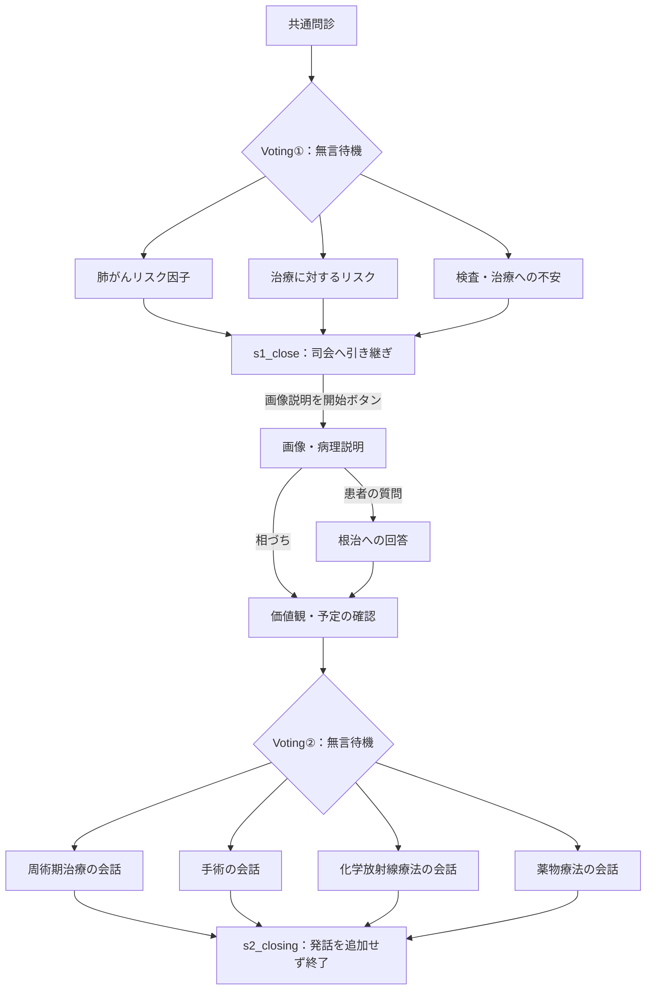

# 台本とノードの対応（haigan-2026）

実行用は [haigan-2026.json](../data/scenarios/haigan-2026.json)、患者の台詞も含む転記用原稿は [haigan-2026-script.md](../data/scenarios/haigan-2026-script.md)。ユーザー提供の「AIアバター\_会話だけの台本.md」を反映し、患者名を鈴木さんへ統一した。

65ノード、追加問診3択 × 治療4択の全12経路。分岐内の医師の一発話を1ノードにし、患者の返答ごとに次へ進む。医師が連続して話す箇所だけ `auto` で連結する。原稿にない投票案内と旧台本の共通クロージングは追加しない。安全網の `s1_symptoms_redirect` のみ既存の仮台詞を残す。

## 会場投票との対応

| 選択肢    | Voting①：追加問診            | 患者の返答回数 | Voting②：治療説明                      | 患者の返答回数 |
| --------- | ---------------------------- | -------------- | -------------------------------------- | -------------- |
| ① / A / 1 | 肺がんリスク因子             | 3              | 術前化学免疫療法 → 手術 → 術後免疫療法 | 8              |
| ② / B / 2 | 治療に対するリスク           | 2              | 手術 ± 術後プラチナ併用療法            | 9              |
| ③ / C / 3 | 検査・治療への不安           | 3              | 化学放射線療法 ± デュルバルマブ        | 10             |
| ④ / D / 4 | 選択肢なし（キー操作も無効） | —              | プラチナ併用療法 ± 免疫療法            | 9              |

Voting待機ではマイクを停止し、オペレーターが分岐を選ぶ。選択直後は最初の医師の台詞だけを読み、患者の返答を待つ。

## 進行と照合

- `patient_any`：有効な患者の返答で1ノード進む。内容の正誤は判定せず、次の固定台詞を返す。患者役は転記用原稿に沿って返答する。「待って」「もう一度」は進めず、保留・直前の台詞の再発話とする。
- `patient_intent`：症状確認と病理説明の分岐。症状なしの定型返答は `matchMode: "exact"` で文全体を照合する。「胸が痛くて眠れない」等を「ない」の部分一致だけで症状なしにはしない。ルールで確定できなければLLM分類へ回し、それもできなければ聞き返す。
- `s1_close`：司会が説明する間はマイクを停止して無言で待つ。`operator` の `present_imaging` 分岐を、`/operator` の「画像説明を開始」ボタンで選ぶ。音声では進まず、遅着した文字起こしや言い直しにも応答しない。開始後は画像・病理説明を読み、患者の返答を待つ。手動の入力停止は開始操作後も維持する。
- `operator`：画像説明の開始と投票結果を操作画面で反映。Voting①は3択、Voting②は4択で、数字キーのショートカットにも対応。画像説明の開始待ちに数字キーを押しても進まない。
- `auto`：同じ医師の連続発話だけを連結。患者の返答を挟む治療説明は連結しない。
- `doctorLines: []`：無言のVoting待機と終端に限る。終端へ進む前の分岐固有の締めは読み上げる。再発話・再接続ではその最後の応答を復元する。

`caseFacts` は参考情報であり、回答生成や矛盾判定には使わない。進行・発話を変更する際は `nodes` を更新する。`revision` は遷移前のノードと台詞を一緒に復元し、結合した患者発話を再判定する。

## ノード一覧

患者待ちは各行の台詞を話し終えてから始まる。`auto` の行は次の台詞と連結される。「無言」は空文字の音声を送るのではなく、状態だけを更新する。

| ノードID                        | 台詞の冒頭                                                                                                      | 次への条件             |
| ------------------------------- | --------------------------------------------------------------------------------------------------------------- | ---------------------- |
| `s1_greeting`                   | こんにちは。山本です。本日はよろしくお願いします。今日は、紹介元の先生から右の肺に影があるということで受診され… | patient_any            |
| `s1_symptoms`                   | 現在、咳、痰、血痰、息切れ、胸の痛み、発熱、体重減少などはありますか。                                          | patient_intent         |
| `s1_symptoms_redirect`          | 仮の安全網：そうでしたか。その症状については、後ほど詳しくお聞かせください。 / 普段の生活はいかがですか。       | patient_any            |
| `s1_adl`                        | 症状はないけれど、定期検査で偶然見つかったということですね。普段の生活はいかがですか。                          | patient_any            |
| `s1_voting1_wait`               | 無言                                                                                                            | operator               |
| `v1_risk_factors`               | タバコを吸ったことはありますか。吸っている場合は、1日に何本くらい吸っていますか？                               | patient_any            |
| `v1_current_smoking`            | 現在もタバコは吸われていますか？                                                                                | patient_any            |
| `v1_occupation`                 | そうですよね。長年の習慣を変えるのは簡単ではありません。ちなみに、お仕事は何をされていますか？工事現場や金属加… | patient_any            |
| `v1_risk_factors_ack`           | ありがとうございます。喫煙という肺癌の重要なリスク因子がありますので、今回の影が癌かどうかは検査で判断する必要… | auto                   |
| `v1_treatment_risk`             | 普段は身の回りのことをご自身でされていますか？ 例えば、買い物や外出など日常生活に支障はないでしょうか？         | patient_any            |
| `v1_exertional_dyspnea`         | お仕事も続けられているんですね。平らな道を歩いたり、階段を上ったりするときに、同年代とくらべて息切れはあります… | patient_any            |
| `v1_treatment_risk_ack`         | ありがとうございます。普段の生活は自立されているようですし、運動習慣もあるので体力の面で心配はなさそうです。た… | auto                   |
| `v1_concerns`                   | これから検査を行い、必要に応じて治療に進んでいきますが、ここまでやこれからに関して何か心配なことはありますか？  | patient_any            |
| `v1_concerns_detail`            | 癌は治したいけれど、治療に対して不安があるということですね。特に心配なのは、どのようなことでしょうか？          | patient_any            |
| `v1_daily_life`                 | それは大切なことですね。今の生活の中で、できるだけ続けたいことはありますか？                                    | patient_any            |
| `v1_concerns_ack`               | ありがとうございます。癌を治すことだけでなく、治療後も今の生活を保てるかどうかが重要なのですね。治療には選ぶお… | auto                   |
| `s1_close`                      | それでは、いろいろ検査を進めていきましょう。                                                                    | 画像説明を開始ボタン |
| `s2_imaging`                    | 画像では、右下葉に約40mmの不整形な結節を認めます。PET-CTでは集積が強く、悪性腫瘍を疑う所見です。                | auto                   |
| `s2_pathology`                  | 病理検査では、非小細胞肺癌のうち扁平上皮癌と診断されています。#7リンパ節にも同じような癌細胞が確認され、リン…   | patient_intent         |
| `s2_cure_answer`                | 根治を目指せる可能性はあります。ただし、リンパ節転移とわずかな間質性肺炎があるため、治療効果とリスクを慎重に比… | auto                   |
| `s2_values`                     | ここで、治療を考える上で大切にしたいことを伺います。治療効果、副作用、入院、仕事や生活への影響など、何を一番重… | patient_any            |
| `s2_values_risk_ack`            | リスクの高い治療は避けたいということですね。とても大切な希望です。近いうちに、どうしても外せない予定はあります… | patient_any            |
| `s2_values_wedding_ack`         | それは大切ですね。根治を目指すことと、結婚式に出席できる状態を保つことの両方を意識して治療計画を考える必要があ… | auto                   |
| `s2_voting2_wait`               | 無言                                                                                                            | operator               |
| `v2_perioperative`              | 今回の肺癌に対して、まず抗がん剤と免疫療法を組み合わせて治療を行い、その後に手術で癌を取り除く方法があります。… | patient_any            |
| `v2_perioperative_rationale`    | はい。今回は肺だけでなく、胸の中央にあるリンパ節にも癌が広がっています。先に薬で治療することで、癌を小さくした… | patient_any            |
| `v2_perioperative_benefit`      | 手術だけを行う場合と比べて、再発を減らす効果が期待できる治療です。ただし、必ず治るというわけではありません。ま… | patient_any            |
| `v2_perioperative_ip_risk`      | 免疫治療・抗がん剤治療・手術などをきっかけに感染症とは異なる肺炎を発症することがまれにありますが、間質性肺炎を… | patient_any            |
| `v2_perioperative_values`       | そのお気持ちはよく分かります。癌を治すことはもちろん大切ですが、治療によって生活が大きく損なわれる可能性につい… | patient_any            |
| `v2_perioperative_duration`     | 手術前の薬物療法には、一般的に約2か月かかります。その後、体調や癌の状態を確認して手術を行います。さらに、手術…  | patient_any            |
| `v2_perioperative_wedding`      | お孫さんの結婚式は、ぜひ出席したい大切なご予定ですね。この方法では、ちょうど3か月後が手術の前後になる可能性が…  | patient_any            |
| `v2_perioperative_planning`     | そうですね。鈴木さんにとっては、癌を治す可能性だけでなく、治療の安全性や結婚式に出席できることも重要なのだと思… | patient_any            |
| `v2_perioperative_closing`      | もちろんです。今すぐ決めていただく必要はありません。根治を目指すことと、できるだけ安全に治療すること、その両方… | auto                   |
| `v2_surgery`                    | 今回の肺がんに対して、先に手術を行い、右の肺にある癌と、癌が広がっているリンパ節を最初に取り除いてしまいます。… | patient_any            |
| `v2_surgery_recurrence`         | 手術で癌を取り除けることは、大きな利点です。ただし、鈴木さんの場合は、胸の中央にあるリンパ節にも癌が転移してい… | patient_any            |
| `v2_surgery_adjuvant`           | はい。そのため、手術後に抗がん剤を追加して、再発の危険性を減らすことも考えます。ただし、鈴木さんの場合は肺の状… | patient_any            |
| `v2_surgery_ip_risk`            | そこは重要な点です。鈴木さんには、もともと間質性肺炎があります。手術によって肺の一部を切除すると、呼吸するため… | patient_any            |
| `v2_surgery_respiratory_risk`   | 息切れが急に強くなったり、血液に十分な酸素を取り込めなくなったりすることがあります。重症になると人工呼吸器など… | patient_any            |
| `v2_surgery_daily_life`         | 手術後に回復して、日常生活に戻れる方が大半です。ただ、どの範囲の肺を切除するかによって、呼吸機能への影響は異な… | patient_any            |
| `v2_surgery_hospitalization`    | はい。入院して手術を受け、その後は呼吸状態などを確認しながら回復を待つことになります。経過が順調なら退院して日… | patient_any            |
| `v2_surgery_wedding`            | 手術を先に行い、順調に回復できれば、3か月後には体力がある程度戻って、結婚式に出席できる可能性は100%ではな…      | patient_any            |
| `v2_surgery_planning`           | そうですよね。癌をしっかり治療したいというお気持ちと、大切なご予定を守りたいというお気持ちの両方があるのだと思… | patient_any            |
| `v2_surgery_closing`            | もちろんです。特に今回はリンパ節転移があるため、手術を最初に行うことが適切かどうかも含めて、治療選択を一緒に検… | auto                   |
| `v2_radiation`                  | 鈴木さん、手術をせずに癌を治すことを目指す方法として、抗がん剤と放射線治療を組み合わせる治療があります。これを… | patient_any            |
| `v2_radiation_benefit`          | はい。手術が難しい場合などにも、根治を目指して行われる治療です。放射線を癌のある部分に当てながら、抗がん剤を使… | patient_any            |
| `v2_radiation_ip_risk`          | 手術で肺を切除しなくて済むことは利点です。ただし、化学放射線療法にも大きな副作用があります。特に鈴木さんの場合… | patient_any            |
| `v2_radiation_pneumonitis`      | 放射線は癌を攻撃しますが、周囲の正常な肺にも影響を与えることがあります。その結果、肺に炎症が起こり、咳や息切れ… | patient_any            |
| `v2_radiation_respiratory_risk` | その可能性があります。特に間質性肺炎がある方では、肺の炎症が広がったり、重症化したりする危険性が、間質性肺炎の… | patient_any            |
| `v2_radiation_duration`         | 一般的には約6週間、平日は毎日放射線治療を受けていただきます。その期間中に抗がん剤も投与します。治療中は疲れや…  | patient_any            |
| `v2_radiation_work`             | 基本的に放射線治療は入院で行います。毎日の通院で治療をする方もいらっしゃいますが、無理をしていただくのは避けた… | patient_any            |
| `v2_radiation_recovery`         | 放射線治療自体は約6週間で終了しますが、その後もしばらく疲労感などが続くことがあります。また、肺の炎症は治療中…  | patient_any            |
| `v2_radiation_wedding`          | 治療が順調に進み、肺の炎症などが起こらなければ、出席できる可能性はあります。ただ、結婚式の頃は放射線肺臓炎が現… | patient_any            |
| `v2_radiation_durvalumab`       | はい。治療後に癌が悪化しておらず、体の状態が許せば、デュルバルマブという免疫療法の薬を追加して、再発を抑えるこ… | patient_any            |
| `v2_radiation_closing`          | そのとおりです。化学放射線療法は根治を目指せる治療ですが、鈴木さんの肺の状態では重大な危険性も考えなければなり… | auto                   |
| `v2_chemo`                      | 鈴木さん、抗がん剤を使って癌を治療する方法もあります。プラチナ製剤という種類の抗がん剤を、別の抗がん剤と組み合… | patient_any            |
| `v2_chemo_purpose`              | はい。手術や放射線治療による負担を避けられることは、この方法の利点です。ただし、抗がん剤そのものにも副作用があ… | patient_any            |
| `v2_chemo_benefit`              | そうです。根治を目指す治療と比べると、癌を治しきる可能性は低くなります。ただし、癌の進行を抑えたり、できるだけ… | patient_any            |
| `v2_chemo_ip_risk`              | 抗がん剤でも、間質性肺炎が悪化する可能性はあります。また、吐き気や食欲低下、倦怠感、感染症などの副作用が起こる… | patient_any            |
| `v2_chemo_immunotherapy`        | はい。免疫療法は、体の免疫の働きを利用して癌を攻撃する治療です。抗がん剤と組み合わせることで、治療効果が高まる… | patient_any            |
| `v2_chemo_schedule`             | 一般的には数週間おきに病院で点滴治療を受けていただきます。治療の種類や体調によって予定は変わりますが、基本的に… | patient_any            |
| `v2_chemo_work`                 | 体調が安定していれば、仕事を続けられる可能性はあります。ただ、抗がん剤の後は疲れやすくなったり、感染症にかかり… | patient_any            |
| `v2_chemo_wedding`              | それは大切なご予定ですね。薬物療法の場合は、治療日程を調整できることもありますので、結婚式に合わせて予定を考え… | patient_any            |
| `v2_chemo_values`               | そうですよね。癌を治したいというお気持ちも、できるだけ今の生活を大切にしたいというお気持ちも、どちらも自然なこ… | patient_any            |
| `v2_chemo_closing`              | ありがとうございます。そのお気持ちは、治療を決めるうえでとても重要です。鈴木さんの場合は、癌を治す可能性を重視… | auto                   |
| `s2_closing`                    | 無言                                                                                                            | 終端                   |

## 原稿から整えた箇所

医学的な説明や数値は提供原稿を使用する。以下は転記時の表記・文法修正であり、原稿の医学的内容の検証を行ったものではない。

| 原稿                                             | 反映内容                                                               |
| ------------------------------------------------ | ---------------------------------------------------------------------- |
| XXさん                                           | ユーザー指定により鈴木さんへ統一                                       |
| 受けらるのか                                     | 受けられるのか                                                         |
| さらに、間質性肺炎が急激に免疫療法によって…      | 文の混在した部分を整理し「さらに、免疫療法によって…」                  |
| 手術で解き切れていれば                           | 手術で取り切れていれば                                                 |
| 抗がん剤治療の追加を検討することを検討しています | 重複を除き「抗がん剤治療の追加を検討しています」                       |
| 考えてイアｍす。。                               | 考えています。                                                         |
| 思います呼吸器内科…                              | 文の境目に句点を追加                                                   |
| 副作用がかるようなら                             | 文脈から「副作用が軽いようなら」と補完                                 |
| リスクの高い治療はしたくと思っています（患者）   | 続く手術を避けたいという希望に合わせ「したくないと思っています」と補完 |
| 問診終了の台詞に句点なし／文末の余分な空白       | 句点追加・余分な空白の除去                                             |

新原稿にある「軽度／わずかな間質性肺炎」「PD-L1が比較的高い」等は台詞に反映。`caseFacts` の間質性肺炎の記述とPD-L1の参考情報も合わせた。具体的なPD-L1値は原稿にないため追加していない。

## 検証・更新

`scenario-engine.test.js` は転記用Markdownの医師・患者の台詞を読み、全12経路の発話順・患者待ち・最後の締めをJSONと照合する。新しい台詞には `script-readings.js` に読みを登録する。既存の安全網と逸脱定型文も読みの検査対象とする。

実行時はJSONをキャッシュするので、差し替え後はサーバーを再起動し、会場・操作画面を再読み込みする。ブラウザテストは外部API・実マイクを模擬し、3択問診・4択治療・司会待ち・患者の返答による進行を通しで検証する。

## 台本外発話の分類と定型応答

症状確認・病理説明で適用する。画像説明の開始待ちは返事をせず、通常の `patient_any` は保留・聞き直し以外の有効な発話で進む。

| 分類           | 例                               | 応答・進行                                           |
| -------------- | -------------------------------- | ---------------------------------------------------- |
| medical_advice | 余命・費用・薬剤選択・投与量など | 専門チームで検討すると受け、現在の台詞へ戻る         |
| case_conflict  | 過去の手術や治療についての発言   | 紹介元の情報を中心に確認すると受け、現在の台詞へ戻る |
| off_topic      | 雑談など                         | 一文で受け、現在の台詞へ戻る                         |
| unclear        | 分類できない候補語・曖昧な否定   | 聞き返しのみ。進行しない                             |
| pause          | 待ってください                   | 準備できたら答えるよう伝え、進行しない               |
| repeat         | もう一度お願いします             | 直前の応答全体を再発話。進行しない                   |

定型文はJSONの `globalDeviationReplies`、分類ルールは `src/features/scenario/deviation-handler.js`。`case_conflict` はキーワード規則であり、`caseFacts` と任意の発話を照合する機能ではない。
