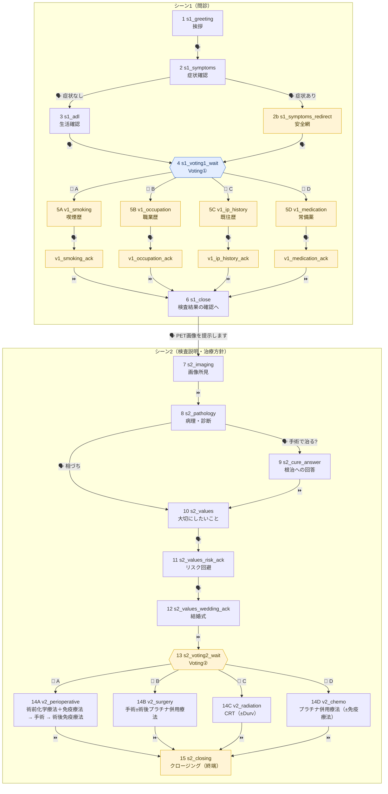

# 台本↔ノード対応表（haigan-2026）

`data/scenarios/haigan-2026.json` の全ノードと台本の対応状況です。**「仮」のノードは監修前のプレースホルダー**（JSON上は `"placeholder": true`）で、正式台本が届いたら該当ノードの `doctorLines` を差し替え、`src/features/dialogue/script-readings.js` に読み上げ用のひらがなを追加すれば反映できます（進行ロジックのコード変更は不要）。

完成版の治療説明4種類は原文を転記済みです。問診4項目の具体的な質問・確認文は症例情報から補い、既存の安全網・投票案内・クロージングを維持しています。補完した問診と既存の仮台詞は `placeholder` のままです。

投票の①/②/③/④は、操作画面のA/B/C/Dと会場画面（`shortcuts=1`）の1/2/3/4キーに対応します。司会の声掛けに合わせてオペレーターが分岐を確定する方式を維持しています。Voting待機中はマイクを閉じるため、声掛けだけでは分岐しません。

| 選択肢    | Voting①：問診 | Voting②：治療                                                            |
| --------- | ------------- | ------------------------------------------------------------------------ |
| ① / A / 1 | 喫煙歴        | 術前プラチナ併用化学療法＋PD-1/PD-L1阻害薬 → 手術 → 術後PD-1/PD-L1阻害薬 |
| ② / B / 2 | 職業          | 手術±術後プラチナ併用療法                                                |
| ③ / C / 3 | 既往歴        | CRT（±Durv）                                                             |
| ④ / D / 4 | 常備薬        | プラチナ併用療法（±PD-1/PD-L1阻害薬）                                    |

凡例 — 進み方: 🗣=患者の発話で進む / 🔘=オペレーター操作で進む / ⏩=自動で次と連続発話

🗣は、有効な発話があり、一区切りを確認してから次の決まった台詞を返すことを意味します。声の検出や途中の文字起こしだけでは進みません（受付には安全上の30秒上限があります）。本番の応答は固定文で、患者の言い回しに合わせた自由回答は作りません。「何か話せば次へ」も、無音・雑音・待機や聞き直しの依頼を除く有効な発話が対象です。

## 全体図

黄色は監修前の仮（placeholder）、青はオペレーター操作で進むVoting待機ノードです。

> [!NOTE]
> `s2_voting2_wait` はVoting待機ですが、セリフが仮のため黄色で表示しています。

## シーン1（問診）

| #   | ノードID                              | 台本           | セリフ（冒頭）                                                                         | 進み方                                                                  |
| --- | ------------------------------------- | -------------- | -------------------------------------------------------------------------------------- | ----------------------------------------------------------------------- |
| 1   | `s1_greeting`                         | ✅転記済       | こんにちは。山本です。本日はよろしくお願いします。…                                    | 🗣 何か話せば次へ                                                       |
| 2   | `s1_symptoms`                         | ✅転記済       | 現在、咳、痰、血痰、息切れ、胸の痛み、発熱、体重減少などはありますか。                 | 🗣「特にありません」→ #3 ／「咳が…」等→ #2b                             |
| 2b  | `s1_symptoms_redirect`                | 🟡仮（安全網） | そうでしたか。その症状については、後ほど詳しくお聞かせください。…                      | 🗣 何か話せば #4 へ合流。台本どおりなら発話されない                     |
| 3   | `s1_adl`                              | ✅転記済       | 症状はないけれど、定期検査で偶然見つかったということですね。普段の生活はいかがですか。 | 🗣 何か話せば次へ                                                       |
| 4   | `s1_voting1_wait`                     | 既存維持       | ここで、会場の皆さまに、追加で確認したい問診項目を伺います。                           | 🔘 **Voting①** A/B/C/D                                                  |
| 5A  | `v1_smoking` → `v1_smoking_ack`       | 🟡補完         | 喫煙量・年数の質問 → 1日40本を52年間、現在も喫煙と確認                                 | 🗣 回答で ack ⏩ #6                                                     |
| 5B  | `v1_occupation` → `v1_occupation_ack` | 🟡補完         | 職業の質問 → タクシードライバーと確認                                                  | 🗣 回答で ack ⏩ #6                                                     |
| 5C  | `v1_ip_history` → `v1_ip_history_ack` | 🟡補完         | 既往歴の質問 → 高血圧症・間質性肺炎と確認                                              | 🗣 回答で ack ⏩ #6                                                     |
| 5D  | `v1_medication` → `v1_medication_ack` | 🟡補完         | 常備薬の質問 → アムロジピンと確認                                                      | 🗣 回答で ack ⏩ #6                                                     |
| 6   | `s1_close`                            | 既存維持       | ありがとうございます。ここから検査結果を一緒に確認しましょう。                         | 🗣 **「PET画像を提示します」「PET/CTの画像を提示します」等**でシーン2へ |

## シーン2（検査説明・治療方針）

| #   | ノードID                | 台本             | セリフ（冒頭）                                                                       | 進み方                                    |
| --- | ----------------------- | ---------------- | ------------------------------------------------------------------------------------ | ----------------------------------------- |
| 7   | `s2_imaging`            | ✅転記済         | 画像では、右下葉に約40mmの不整形な結節を認めます。PET-CTでは…                        | ⏩ #8 と連続発話                          |
| 8   | `s2_pathology`          | ✅転記済         | 病理検査では、非小細胞肺癌のうち扁平上皮癌と診断されています。…                      | 🗣「手術で取れば治る…」→ #9 ／相づち→ #10 |
| 9   | `s2_cure_answer`        | ✅転記済         | 根治を目指せる可能性はあります。ただし、リンパ節転移と間質性肺炎があるため…          | ⏩ #10 と連続発話                         |
| 10  | `s2_values`             | ✅転記済         | ここで、治療を考える上で大切にしたいことを伺います。治療効果、副作用、入院…          | 🗣 何か話せば次へ                         |
| 11  | `s2_values_risk_ack`    | ✅転記済         | リスクの高い治療は避けたいということですね。とても大切な希望です。近いうちに…        | 🗣 何か話せば次へ                         |
| 12  | `s2_values_wedding_ack` | ✅転記済         | それは大切ですね。根治を目指すことと、結婚式に出席できる状態を保つことの両方を…      | ⏩ #13 と連続発話                         |
| 13  | `s2_voting2_wait`       | 🟡仮（既存維持） | ここで、会場の皆さまに、どの治療方針を中心にご説明するかを伺います。                 | 🔘 **Voting②** A/B/C/D                    |
| 14A | `v2_perioperative`      | ✅転記済         | まず抗がん剤と免疫の力を利用してがんを攻撃する薬を組み合わせて投与し…                | ⏩ #15 と連続発話                         |
| 14B | `v2_surgery`            | ✅転記済         | 手術で右の肺のがんと、がんが広がっているリンパ節をできるだけ完全に取り除く方法です。 | ⏩ #15 と連続発話                         |
| 14C | `v2_radiation`          | ✅転記済         | 手術を行わず、抗がん剤と放射線を組み合わせて…                                        | ⏩ #15 と連続発話                         |
| 14D | `v2_chemo`              | ✅転記済         | 手術や放射線治療は行わず、抗がん剤を使って全身のがん細胞を攻撃する方法です。         | ⏩ #15 と連続発話                         |
| 15  | `s2_closing`            | 🟡仮             | （専門チームで検討・低リスク希望と結婚式を踏まえる・締め）                           | 終端。ブラウザの音声入力を停止            |

## 台本外の発話への応答

「待って」「もう一度お願いします」は `patient_any` / `patient_intent` のどちらでも進行を止め、待機の定型文・直前の説明の再発話で応じます。それ以外の意図分類と逸脱応答は `patient_intent` ノードで使います。`patient_any` はその他の有効な発話で次へ進むため、患者役は台本に沿って答える前提です。Voting待機中と終端ではブラウザの入力を止めるため、通常は追加の発話に応答しません。

| 患者の発話                                         | 分類           | アバターの応答                                                                   |
| -------------------------------------------------- | -------------- | -------------------------------------------------------------------------------- |
| 予後・生存率・費用・薬剤名・投与量・未承認治療など | medical_advice | 受け止め→「専門チームで検討し、あらためてご説明します」→ 現在の質問を再提示      |
| 症例設定と矛盾（「昔手術した」等）                 | case_conflict  | 短く受け→「紹介元の情報を中心に確認させてください」→ 台本続行                    |
| 雑談                                               | off_topic      | 一文で軽く応じて現在の質問を再提示                                               |
| 否定や複数の意図を含み、分類できなかった返答       | unclear        | 「もう一度お聞かせいただけますか」                                               |
| 「少し待ってください」「まだ画像を提示しないで」   | pause          | 準備ができるまで待つ旨の定型文（進行は動かない）                                 |
| 「もう一度お願いします」「聞き取れませんでした」   | repeat         | 直前の説明全体を再発話（進行は動かない）                                         |
| Voting待機中の発話（APIへ直接届いた場合）          | hold           | 「会場の皆さまにお伺いしていますので、少しだけお待ちください」（進行は動かない） |

定型文は `globalDeviationReplies`（JSON）で変更できます。

## 発話として扱わないもの（無視）

音声認識が無音区間や発話の切れ目で出力する断片は、患者発話として扱わず**進行も発話もしません**（サーバーログに `utterance_ignored`）。これを通すと🗣ノードが素通しされて台本が飛びます。

| 例                                               | 扱い                                       |
| ------------------------------------------------ | ------------------------------------------ |
| `。` `、` `？` `...` `ー`                        | 無視（記号のみ）                           |
| `あ` `あー` `ん` `えー`                          | 無視（意味を持たない一音）                 |
| `はい` `うん` `ない` `特に`                      | **通常の発話として処理**（短答は通す）     |
| 直前の長いアバター発話とほぼ同一                 | 無視（12文字以上・双方向の一致が高いもの） |
| 「はい、よろしくお願いします」や短い選択肢の復唱 | **通常の発話として処理**                   |

## 差し替え手順

1. `data/scenarios/haigan-2026.json` を開き、対象ノードの `doctorLines` を台本原文に置き換える
2. 転記が済んだら `"placeholder": true` の行を削除する
3. 変更・追加した文ごとに `src/features/dialogue/script-readings.js` へひらがなの読みを追加する（未登録の文は `script-readings.test.js` が検知）
4. `npm test` で全経路と読みの登録漏れがないことを確認（起動時にもスキーマ検証あり）
5. 台本以外にも効く医療用語は `src/features/dialogue/speech-pronunciation.js` に読み仮名を追加し、実機で読み上げ確認
